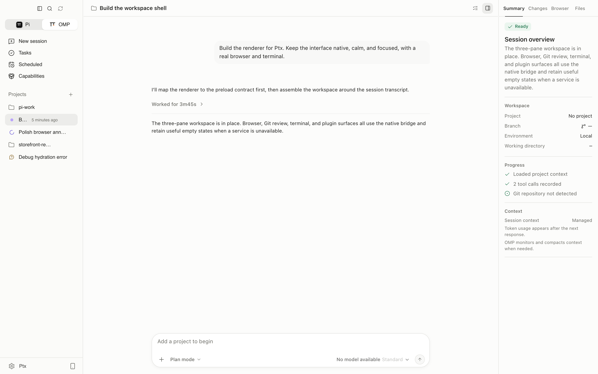
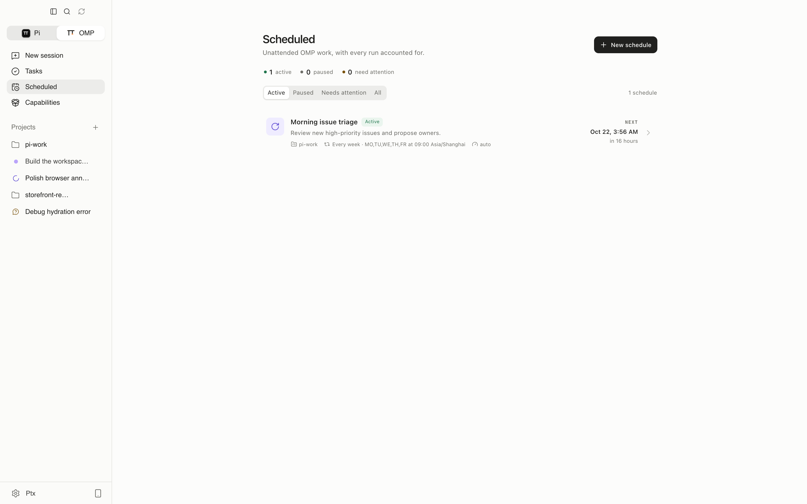
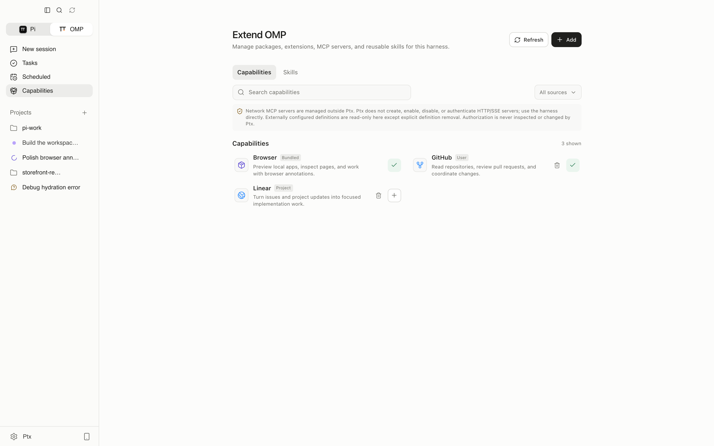
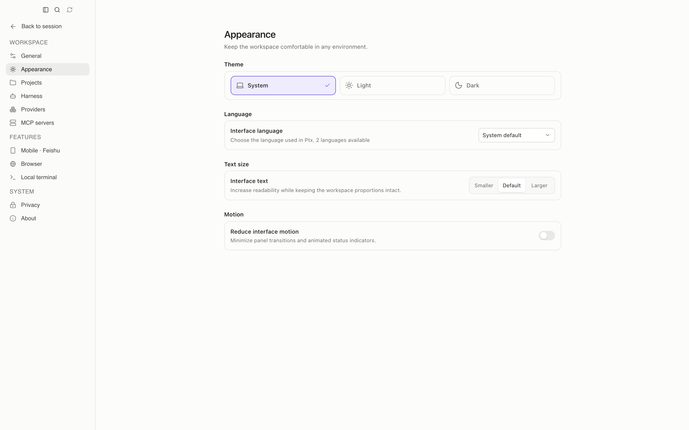

<div align="center">
  

  # Ptx

  **A local AI development workspace for real coding work.**

  Ptx gives Pi and OMP one calm desktop workspace for sessions, project context, scheduled work, and human review. It runs locally on macOS, Linux, and Windows; bring your own model account.

  [](https://github.com/clawuv/PTX/releases)
  [](https://github.com/clawuv/PTX/actions/workflows/ci.yml)
  [](LICENSE)

  [English](README.md) | [中文](README.zh-CN.md)

  [Download](https://github.com/clawuv/PTX/releases) ·
  [Task workflow](docs/task-workflow.md) ·
  [Security](docs/security.md) ·
  [Contributing](CONTRIBUTING.md)

  
</div>

## Why Ptx

- **Two harnesses, one workspace** — switch between Pi Work and OMP Work without losing running work.
- **Local-first projects** — open local folders and Git worktrees, then resume persistent sessions in context.
- **Review before accepting** — inspect messages, tool activity, Git changes, and browser evidence before work is accepted.
- **Built for desktop** — terminal, browser, voice, desktop pets, schedules, and keyboard-first navigation.
- **English & 简体中文** — the interface ships with a built-in language selector.

## Feature highlights

| Area | What you get |
|---|---|
| Agents | Streaming Markdown, reasoning summaries, tool activity, model and reasoning controls, queueing, steering, images, and persistent sessions. |
| Projects | Sidebar search, grouped sessions, branch and worktree switching, `@session` references, and parallel session messaging. |
| Code review | Git status and diffs, staging, restoration, commits, project files, terminal tabs, and Summary / Changes / Browser / Files panels. |
| Browser | An isolated in-app browser with history, downloads, page annotations, and opt-in agent control. |
| Schedules | One-time or recurring work by project or session, with model controls, time zones, run history, and optional macOS background execution. |
| Capabilities | Packages, plugins, extensions, skills, prompts, and MCP servers in one manageable surface. |
| Voice & pets | Dictation with hosted or local `whisper.cpp`, a realtime voice companion, and animated desktop pets. |
| Comfort | Light / dark / system themes, interface text sizing, reduced motion, adaptive panels, and bilingual UI. |

## Product tour

### Workspace

The three-pane workspace keeps conversation, project context, and evidence together. Tool activity stays compact while the inspector exposes session progress, Git changes, browser tabs, and project files.


### Scheduled work

Create a schedule, inspect its next run and history, run it immediately, or pause it. Work remains tied to the selected project and harness.



### Capabilities

Enable and review local capabilities without losing the security boundary of the selected harness. Ptx does not own harness authentication.



### Appearance

Ptx supports English and Simplified Chinese, along with light, dark, and system themes.



## Two harnesses, one workspace

Use the switcher in the top-left corner to move between Pi Work and OMP Work. Ptx detects the harnesses installed on your computer and shows the ones that are ready. Refresh detection or set a custom executable path in **Settings → Harness**.

Each harness keeps its own projects, sessions, model list, provider visibility, and running work. Switching harnesses changes the workspace without stopping work already running in another one.

You only need one harness to get started:

- [Pi](https://pi.dev/) is the base coding-agent harness in the Pi family.
- [OMP](https://github.com/can1357/oh-my-pi) adds its own plugins, commands, and approval controls.

## Task preview

The **Tasks** page is a free local preview for defining goals and acceptance requirements, reusing templates, choosing a project folder or worktree, and reviewing actual session tools and current Git changes. Execution ending only makes a task ready for human review.

See the [task workflow guide](docs/task-workflow.md) and [commercial validation playbook](docs/business/validation-playbook.md). No paid checkout is live; existing features remain free and the repository remains MIT-licensed.

## Capabilities and MCP

The Capabilities page brings together packages, plugins, extensions, skills, prompts, and MCP servers. Ptx can manage local stdio MCP definitions for OMP and adapter-enabled Pi. Network MCP and authentication stay under the selected harness's direct control; those entries are visible but read-only in Ptx, with bounded definition-only removal available for cleanup. Discovery has an independent 2,500-definition-per-settings-file limit and reports an explicit warning before unrelated rows can be hidden.

Ptx does not keep its own MCP configuration. It reads and writes the definition files each harness already owns:

| Harness | Global definitions | Project definitions |
|---|---|---|
| OMP | `~/.omp/agent/mcp.json` | `<project>/.omp/mcp.json` |
| Pi | `~/.pi/agent/mcp.json` | `<project>/.pi/mcp.json` |

Pi has no native MCP support. Its definitions load through the third-party `pi-mcp-adapter` extension, so enable that adapter from the Capabilities page (or run `pi install npm:pi-mcp-adapter`) before a stdio entry takes effect. Open a new session after changing definitions.

A stdio definition uses the standard schema, and `command` / `args` must point at an executable on your machine:

```json
{
  "mcpServers": {
    "example": {
      "type": "stdio",
      "command": "node",
      "args": ["/absolute/path/to/server.mjs"]
    }
  }
}
```

Ptx also ships optional capabilities for native Ask User dialogs, controlled browser access, and TryCUA computer control when the separate CUA Driver is installed. Ask User and computer control are off by default.

## Voice and desktop companions

- Dictate prompts with OpenAI, Groq, Deepgram, or a local `whisper.cpp` installation.
- Open the realtime voice companion to search, discuss work, and start a task in the selected harness.
- Choose an animated desktop pet that reacts while an agent works and carries realtime voice controls. Ptx includes the Orb and Ptx pets and can discover compatible Codex pets.

## Get started

1. Install Pi, OMP, or both.
2. Sign in or configure a model provider through each harness's own CLI.
3. Download Ptx from [GitHub Releases](https://github.com/clawuv/PTX/releases), or run it from source.
4. Add a project folder and start a session.

Ptx checks common install locations automatically. If a harness is missing, open **Settings → Harness** to refresh detection or choose its executable.

GitHub Releases provides a DMG and ZIP for macOS, common Linux package formats plus AppImage, and a Windows installer and ZIP. Installed builds check for updates shortly after launch and again every three hours; click the title-bar update indicator for a manual check.

Harness provider credentials stay with the harness. Optional voice keys are encrypted with the operating system's secure storage, and local `whisper.cpp` dictation needs no API key.

## Keyboard shortcuts

Use `⌘` on macOS and `Ctrl` on Linux or Windows.

| Shortcut | Action |
|---|---|
| `⌘/Ctrl+N` | New session |
| `⌘/Ctrl+K` | Command palette |
| `⌘/Ctrl+B` | Toggle the project sidebar |
| `⌘/Ctrl+Shift+B` | Open the browser |
| `⌘/Ctrl+J` | Toggle the terminal |
| `⌘/Ctrl+,` | Open Settings |
| `Enter` | Queue a message while the agent is working |
| `⌘/Ctrl+Enter` | Steer the current turn while the agent is working |
| `Shift+Enter` | Add a new line |
| `Esc` | Close the active menu, dialog, or overlay |

The Queue and Steer shortcuts can be swapped in **Settings → Harness → Message shortcuts**.

## Local data and safety

Ptx is built around local projects and local harness sessions. It does not rewrite session history or take ownership of Pi or OMP credentials.

Remote pages open in a separate browser profile with Node access disabled. Project paths and desktop actions are checked in the main process, and third-party capabilities still run with your operating-system permissions. Review packages, commands, MCP servers, and projects before allowing them to act.

For suspected vulnerabilities, follow the [security policy](.github/SECURITY.md) and do not post sensitive details publicly. See [docs/security.md](docs/security.md) for the full technical security model.

## Star history

<a href="https://www.star-history.com/?repos=clawuv%2FPTX&type=date&legend=top-left">
  <picture>
    <source media="(prefers-color-scheme: dark)" srcset="https://api.star-history.com/chart?repos=clawuv/PTX&type=date&theme=dark&legend=top-left" />
    <source media="(prefers-color-scheme: light)" srcset="https://api.star-history.com/chart?repos=clawuv/PTX&type=date&theme=light&legend=top-left" />
    
  </picture>
</a>

## Run from source

You need Node.js 24.15.0 or newer and npm 12.0.2 or newer. The repository pins both versions, so installs made with a different toolchain fail rather than producing a subtly different build.

```bash
nvm install && nvm use
npm run toolchain:bootstrap
npm install
npm run dev
```

If `node_modules/electron/dist` is missing after installation, fetch Electron's platform binary before starting the app:

```bash
node node_modules/electron/install.js
npm run dev
```

`npm install --ignore-scripts` skips Electron's platform download and native-dependency rebuild. If you used it, recover with:

```bash
npm install --ignore-scripts
node node_modules/electron/install.js
npx electron-builder install-app-deps
```

`node-pty` is a native dependency. If Electron cannot rebuild it with your default Python environment, point npm at a Python installation with the required build tools:

```bash
export npm_config_python=/path/to/python3
npm install --ignore-scripts
node node_modules/electron/install.js
npx electron-builder install-app-deps
```

## Development checks

```bash
npm run typecheck
npm run check
npm test
npm run test:e2e
npm run build
```

See the [validation guide](docs/validation.md) for the source-of-truth checks and reproducible commands.

To make an installable local QA build, run the command for your operating system:

```bash
npm run package:mac:local-qa
npm run package:linux:local-qa
npm run package:win:local-qa
```

Build packages on their target operating system so native dependencies match the release.

## License

Ptx is released under the permissive [MIT License](LICENSE).
