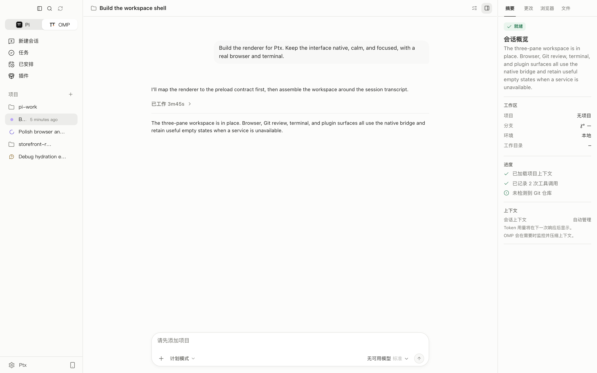
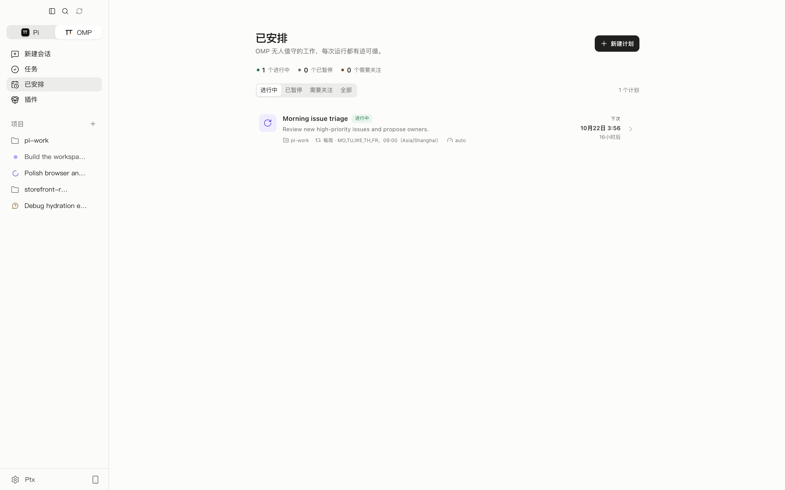
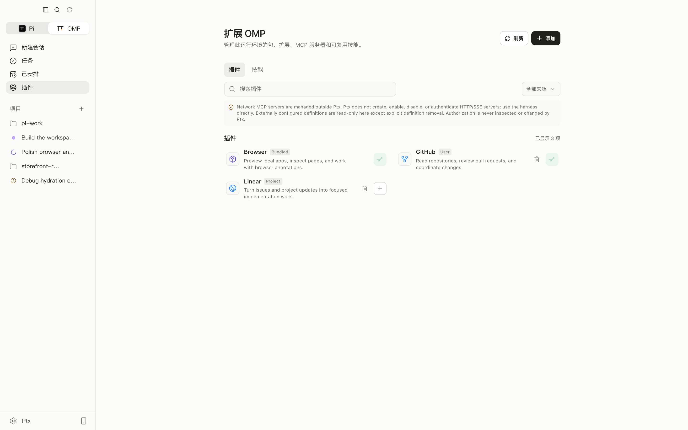
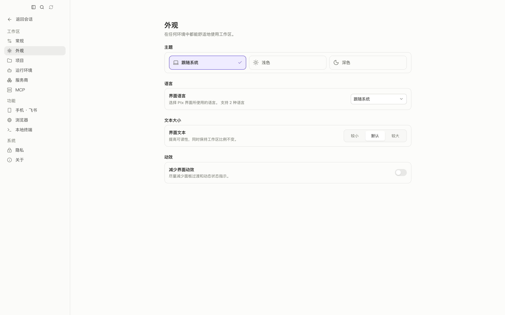

<div align="center">
  

  # Ptx

  **面向真实开发工作的本地 AI 工作区。**

  Ptx 为 Pi 和 OMP 提供一个统一的桌面工作区，用于管理会话、项目上下文、计划任务和人工审查。应用本地运行在 macOS、Linux 和 Windows 上，模型账号由你自带。

  [](https://github.com/clawuv/PTX/releases)
  [](https://github.com/clawuv/PTX/actions/workflows/ci.yml)
  [](LICENSE)

  [English](README.md) | [中文](README.zh-CN.md)

  [下载](https://github.com/clawuv/PTX/releases) ·
  [任务流程](docs/task-workflow.md) ·
  [安全模型](docs/security.md) ·
  [参与贡献](CONTRIBUTING.md)

  
</div>

## 为什么选择 Ptx

- **两套运行环境，一个工作区** — 在 Pi Work 和 OMP Work 之间切换，不中断已在运行的工作。
- **本地优先** — 打开本地文件夹和 Git worktree，在项目上下文中恢复持久会话。
- **先审查，再接受** — 检查消息、工具活动、Git 更改和浏览器证据后再接受结果。
- **桌面级体验** — 内置终端、浏览器、语音、桌面宠物、计划任务和键盘优先导航。
- **English & 简体中文** — 应用内置语言选择器。

## 功能亮点

| 领域 | 能力 |
|---|---|
| 智能体 | 流式 Markdown、推理摘要、工具活动、模型与推理控制、排队追问、转向引导、图片输入和持久会话。 |
| 项目 | 侧栏搜索、按项目分组、分支与 worktree 切换、`@session` 引用，以及并行会话消息。 |
| 代码审查 | Git 状态与差异、暂存、还原、提交、项目文件、多个终端标签页，以及摘要 / 更改 / 浏览器 / 文件面板。 |
| 浏览器 | 隔离的内建浏览器，支持历史记录、下载、页面标注，以及可选的智能体控制。 |
| 计划任务 | 按项目或会话创建一次性 / 周期任务，支持模型控制、时区、运行历史和 macOS 后台执行。 |
| 能力扩展 | 在一个界面管理包、插件、扩展、技能、提示词和 MCP 服务器。 |
| 语音与宠物 | 支持托管服务或本地 `whisper.cpp` 听写、实时语音伴侣，以及动态桌面宠物。 |
| 使用舒适 | 浅色 / 深色 / 跟随系统主题、界面文本大小、减少动效、自适应面板和双语界面。 |

## 产品预览

### 工作区

三栏工作区把对话、项目上下文和证据放在一起。工具活动保持紧凑，检查器展示会话进度、Git 更改、浏览器标签页和项目文件。


### 已安排

创建计划后可以查看下一次运行和历史记录，也可以立即运行、暂停或恢复。任务始终绑定到所选项目和运行环境。



### 插件

启用和审查本地能力，同时不越过所选运行环境的安全边界。Ptx 不会接管运行环境的身份认证。



### 外观

Ptx 支持英语和简体中文，并提供浅色、深色和跟随系统主题。



## 两套运行环境，一个工作区

使用左上角切换器在 Pi Work 和 OMP Work 之间移动。Ptx 会自动检测电脑上已安装的运行环境，并显示就绪项。你可以在 **设置 → 运行环境** 中刷新检测或指定自定义可执行文件路径。

每个运行环境都有独立的项目、会话、模型列表、服务商可见性和正在运行的工作。切换运行环境会更换工作区，但不会停止另一个环境中已经在运行的工作。

只需要其中一套即可开始：

- [Pi](https://pi.dev/) 是 Pi 家族的基础编程智能体运行环境。
- [OMP](https://github.com/can1357/oh-my-pi) 提供自己的插件、命令和审批控制。

## 任务预览

**任务**页面是免费本地预览：定义目标和验收要求、复用模板、选择项目文件夹或 worktree，并审查实际会话工具和当前 Git 更改。执行结束只会让任务进入“等待人工审查”状态。

详情见 [任务流程指南](docs/task-workflow.md) 和 [商业化验证手册](docs/business/validation-playbook.md)。目前没有开启付费结算；现有功能保持免费，仓库继续采用 MIT 许可证。

## 能力与 MCP

插件页面汇集包、插件、扩展、技能、提示词和 MCP 服务器。Ptx 可以管理 OMP 以及启用适配器的 Pi 的本地 stdio MCP 定义。网络 MCP 和身份认证始终由所选运行环境直接控制；这些条目在 Ptx 中可见但只读，仅提供有边界的“仅删除定义”清理能力。每个配置文件的 MCP 发现上限为 2,500 个定义；达到上限时会显式警告，避免其他能力行被隐藏。

Ptx 不保存自己的 MCP 配置，而是读写每个运行环境已经拥有的定义文件：

| 运行环境 | 全局定义 | 项目定义 |
|---|---|---|
| OMP | `~/.omp/agent/mcp.json` | `<project>/.omp/mcp.json` |
| Pi | `~/.pi/agent/mcp.json` | `<project>/.pi/mcp.json` |

Pi 没有原生 MCP 支持。其定义通过第三方 `pi-mcp-adapter` 扩展加载，因此必须先在插件页面启用该适配器（或运行 `pi install npm:pi-mcp-adapter`），stdio 条目才会生效。修改定义后请打开新会话。

stdio 定义使用标准 schema，`command` / `args` 必须指向本机存在的可执行文件：

```json
{
  "mcpServers": {
    "example": {
      "type": "stdio",
      "command": "node",
      "args": ["/absolute/path/to/server.mjs"]
    }
  }
}
```

Ptx 还附带可选能力：原生“询问用户”对话框、受控浏览器访问，以及安装独立 CUA Driver 后的 TryCUA 电脑控制。“询问用户”和电脑控制默认关闭。

## 语音与桌面伴侣

- 使用 OpenAI、Groq、Deepgram 或本地 `whisper.cpp` 进行提示词听写。
- 打开实时语音伴侣，搜索资料、讨论工作，并在所选运行环境中启动任务。
- 选择动态桌面宠物；它会在智能体工作时做出反应，并承载实时语音控制。Ptx 内置 Orb 和 Ptx 宠物，也能发现兼容的 Codex 宠物。

## 开始使用

1. 安装 Pi、OMP，或两者都安装。
2. 通过每个运行环境自己的 CLI 登录或配置模型服务商。
3. 从 [GitHub Releases](https://github.com/clawuv/PTX/releases) 下载 Ptx，或从源码运行。
4. 添加项目文件夹并开始会话。

Ptx 会自动检查常见安装位置。如果找不到运行环境，请打开 **设置 → 运行环境** 刷新检测或选择可执行文件。

GitHub Releases 提供 macOS 的 DMG 和 ZIP、常见 Linux 包格式和 AppImage，以及 Windows 安装程序和 ZIP。安装版会在启动后不久检查更新，之后每三小时检查一次；也可以点击标题栏更新指示器手动检查。

运行环境的服务商凭据仍归运行环境所有。可选语音密钥使用操作系统安全存储加密；本地 `whisper.cpp` 听写不需要 API 密钥。

## 键盘快捷键

macOS 使用 `⌘`，Linux 和 Windows 使用 `Ctrl`。

| 快捷键 | 操作 |
|---|---|
| `⌘/Ctrl+N` | 新建会话 |
| `⌘/Ctrl+K` | 命令面板 |
| `⌘/Ctrl+B` | 显示 / 隐藏项目侧栏 |
| `⌘/Ctrl+Shift+B` | 打开浏览器 |
| `⌘/Ctrl+J` | 显示 / 隐藏终端 |
| `⌘/Ctrl+,` | 打开设置 |
| `Enter` | 智能体工作时排队发送消息 |
| `⌘/Ctrl+Enter` | 智能体工作时转向当前回合 |
| `Shift+Enter` | 换行 |
| `Esc` | 关闭当前菜单、对话框或浮层 |

可以在 **设置 → 运行环境 → 消息快捷键** 中交换“排队”和“转向”。

## 本地数据与安全

Ptx 围绕本地项目和本地运行环境会话构建，不会重写会话历史，也不会接管 Pi 或 OMP 凭据。

远程页面在禁用 Node 访问的独立浏览器配置中打开。项目路径和桌面操作会在主进程中校验；第三方能力仍会以你的操作系统权限运行。在允许包、命令、MCP 服务器和项目执行操作前，请先审查它们。

如果发现疑似漏洞，请遵循[安全策略](.github/SECURITY.md)，不要公开敏感细节。完整技术安全模型见 [docs/security.md](docs/security.md)。

## Star 历史

<a href="https://www.star-history.com/?repos=clawuv%2FPTX&type=date&legend=top-left">
  <picture>
    <source media="(prefers-color-scheme: dark)" srcset="https://api.star-history.com/chart?repos=clawuv/PTX&type=date&theme=dark&legend=top-left" />
    <source media="(prefers-color-scheme: light)" srcset="https://api.star-history.com/chart?repos=clawuv/PTX&type=date&theme=light&legend=top-left" />
    
  </picture>
</a>

## 从源码运行

需要 Node.js 24.15.0 或更新版本，以及 npm 12.0.2 或更新版本。仓库固定了这两个版本；使用不同工具链安装会直接失败，而不是产生难以察觉的差异构建。

```bash
nvm install && nvm use
npm run toolchain:bootstrap
npm install
npm run dev
```

如果安装后缺少 `node_modules/electron/dist`，请先获取 Electron 平台二进制文件：

```bash
node node_modules/electron/install.js
npm run dev
```

`npm install --ignore-scripts` 会跳过 Electron 平台下载和原生依赖重建。如果使用了它，请按以下方式恢复：

```bash
npm install --ignore-scripts
node node_modules/electron/install.js
npx electron-builder install-app-deps
```

`node-pty` 是原生依赖。如果 Electron 无法使用默认 Python 环境重建它，请让 npm 指向具备构建工具的 Python：

```bash
export npm_config_python=/path/to/python3
npm install --ignore-scripts
node node_modules/electron/install.js
npx electron-builder install-app-deps
```

## 开发检查

```bash
npm run typecheck
npm run check
npm test
npm run test:e2e
npm run build
```

权威验证说明和可复现命令见 [验证指南](docs/validation.md)。

如需创建可安装的本地 QA 构建，请运行对应操作系统的命令：

```bash
npm run package:mac:local-qa
npm run package:linux:local-qa
npm run package:win:local-qa
```

请始终在目标操作系统上打包，确保原生依赖与发布版本一致。

## 许可证

Ptx 采用宽松的 [MIT 许可证](LICENSE) 发布。
