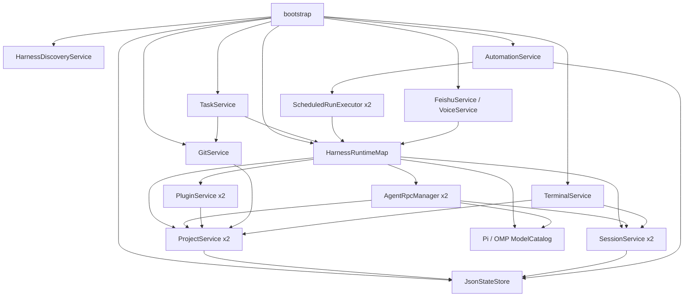

# 01 总体架构

[返回目录](README.md) · [下一章：代理运行时](02-agent-runtime.md)

## 1. 系统定位与边界

Ptx 是单仓库桌面应用，不是前后端独立部署的网站，也不需要数据库服务器。核心是一个 Electron 主进程、一层 preload 和 React 渲染进程；外部 harness、PTY、Git 工具及远程网页具有独立的运行边界。

| 层 | 主要入口 | 职责 | 不应承担的职责 |
| --- | --- | --- | --- |
| 主进程 | [index.ts](../../electron/main/index.ts) | 生命周期、服务实例、进程、文件系统、平台能力 | 不直接实现 React 页面 |
| IPC 门禁 | [ipc.ts](../../electron/main/ipc.ts) | 主窗口来源验证、固定通道、服务路由 | 不接受任意通道或任意系统命令 |
| Preload | [index.ts](../../electron/preload/index.ts) | 冻结的类型化 `window.ptx` API，事件取消订阅 | 不暴露 `ipcRenderer` 或 Node 通用接口 |
| Renderer | [main.tsx](../../src/main.tsx)、[App.tsx](../../src/App.tsx) | 工作区、视图、事件展示、用户交互 | 不直接导入 Node 或主进程模块 |
| Harness 子进程 | [RpcRuntime](../../electron/main/agent-rpc/runtime.ts) | 模型调用、工具执行、会话持久化 | 凭证不迁入 Ptx |
| Browser Guest | [AgentBrowserLayer](../../src/components/AgentBrowserLayer.tsx) | 承载远程网页，主进程审批并控制 | 不获得应用 preload、Node 或 IPC 权限 |

共同类型集中在 [src/types/api.ts](../../src/types/api.ts)，任务和飞书进一步拆到独立类型文件。主进程可以复用无 Node 依赖的共享类型/纯逻辑；反向从 renderer 导入主进程代码是禁止方向。

## 2. 目录导航

```text
PTX/
  electron/
    main/
      index.ts                 启动、窗口、安全策略、服务装配
      ipc.ts                   固定 IPC 注册与来源门禁
      agent-rpc/               RPC 管理、传输、协议适配
      sessions/                只读目录、元数据和转录
      plugins/                 能力发现、安装、MCP 配置
      browser/                 代理浏览器控制
      collaboration/           会话间通信
      schedules/               时间计算、执行、通知与代理入口
      tasks/                   开发任务状态与验收
      feishu/                  手机接入、会话同步、卡片与图片
      *.ts                     项目、Git、终端、存储、语音等服务
    preload/index.ts           唯一应用桥接入口
  src/
    App.tsx                    UI 组合根
    app/                       工作区事件和转录归并逻辑
    hooks/                     状态及异步生命周期
    components/                聊天、侧栏、终端、检查面板
    pages/                     项目、任务、活动、调度、能力、设置
    lib/                       纯逻辑、i18n、展示与输入辅助
    types/                     跨进程接口契约
    styles/                    分界面语义 CSS
  assets/
    extensions/                注入 Pi/OMP 的工具扩展
    skills/                    模型侧指南与调度客户端
    pets/                      内置桌面宠物资源
  tests/                       backend、frontend、unit、e2e 等
  scripts/release/              工具链、审计、打包与验证
  vendor/                      经校验的 npm 工具链归档
  docs/                        设计、使用与工程文档
  out/                         Electron Vite 构建产物
  release/                     本机打包产物
```

`node_modules/`、`out/`、`coverage/`、`test-results/`、`release/` 是依赖或生成目录，不应被当作手写架构入口。

## 3. 服务装配图



图中箭头表示使用或注入关系，不代表所有模块直接 import 对方。多数服务通过构造参数接收授权函数、执行函数或接口片段，测试可替换这些依赖。

### 3.1 HarnessRuntimeMap

[createHarnessRuntimeMap](../../electron/main/harness-runtime.ts) 返回冻结的 `Record<HarnessId, HarnessRuntime>`。每个引擎拥有五种服务：

- `projects`：该引擎的目录授权视图。
- `sessions`：该引擎的会话根、目录和解析器。
- `agents`：该引擎的运行时管理器。
- `catalog`：模型目录提供者。
- `plugins`：该引擎的能力目录与变更入口。

此结构将“按引擎选择服务”集中到一个注册表中，减少多个平行字段之间接错依赖的可能性。

### 3.2 共享服务

Git 与终端不区分模型协议。装配时使用 `authorizeEitherCwd` 等回调，允许任一引擎的有效项目授权满足共享本地工具的授权要求。**这不代表 Pi 的项目授权能启动 OMP runtime**：代理管理器仍绑定各自的 `ProjectService`。

任务、飞书、语音和定时执行都复用注册表或同等作用的按引擎映射，不另建一套代理执行系统。

## 4. 启动流程

源码入口：[electron/main/index.ts](../../electron/main/index.ts)。

1. 注册 `prime-work` 特权协议名称，安装异常防护，申请单实例锁。
2. `app.whenReady()` 后注册打包资源处理器、权限策略及浏览器隔离分区。
3. `bootstrap()` 打开应用 userData，加载会话消息签名 key 和 v4 状态存储。
4. 创建 macOS 后台控制器，发现可运行的 CLI，并校准 `activeHarness`。
5. 构建 Pi/OMP 会话、项目、模型和运行时服务，绑定会话 rename/stop 等 runtime hooks。
6. 创建共享 Git、终端、下载、设置、语音、宠物和能力服务。
7. 构建 `HarnessRuntimeMap`，创建开发任务服务及飞书服务。
8. 创建两种引擎的定时执行器，启动调度状态恢复；启动调度、浏览器、协作的回环 broker。
9. 给各管理器注入 runtime 环境生成器及 capability token 的绑定/撤销回调。
10. 注册 IPC、代理事件 sink、更新事件 sink 和原生菜单，创建主窗口。
11. 主窗口加载可信 URL，`did-finish-load` 才授权该 renderer；前端 bootstrap 读取元数据、配置、项目及会话。
12. 启动更新检查，异步恢复已启用的飞书连接。

启动并不自动打开每个历史会话的 CLI。模型目录探测和实际 runtime 创建均有各自入口。

## 5. 窗口与打包资源

关键函数：

| 函数 | 作用 |
| --- | --- |
| `resolveRendererAssetPath` | 将协议 URL 路径约束到 `out/renderer`，阻断路径越界 |
| `registerRendererProtocol` | 为打包资源提供 MIME、CSP 与 `nosniff` |
| `resolveRendererUrl` | 选择打包协议 URL，或验证开发 loopback URL |
| `hardenRenderer` | 禁止弹窗、限制导航，并为 webview 清除 preload/Node 能力 |
| `createWindow` | 创建沙箱窗口，绑定授权与回收事件 |
| `ensureWindow` | 合并并发建窗请求，避免激活事件重复创建窗口 |
| `loadInitialRenderer` | 加载失败时销毁窗口，避免半初始化窗口遗留 |

开发时 renderer 由 Electron Vite 提供；打包时使用 `prime-work://app/`。保留旧协议名是兼容决定，不能据此推断仍存在 Prime 引擎。

macOS 使用隐藏内嵌标题栏、系统窗口按钮及 vibrancy；Windows/Linux 使用自绘标题区域配合原生窗口框架。菜单命令、缩放和窗口操作均通过主进程执行。

## 6. 事件分发

`forwardAgentEvent` 将两种引擎的 `AgentEventEnvelope` 汇聚到同一条分发路径：

1. `runtime_exit` 清理主进程注册的 pending session。
2. `FeishuService.onAgentEvent` 更新移动端回复/图片同步状态。
3. `TaskService.onAgentEvent` 更新任务生命周期并持久化。
4. 若主窗口仍处于可信主框架 URL，则发送 `agent:event`。

会话目录、浏览器状态、调度与更新还有各自事件通道。React 侧不是所有事件都写入当前聊天：必须按 `runtimeId`、session 与 workspace generation 路由。

## 7. 退出流程

主进程区分“关闭窗口”与“退出应用”。macOS 用户可显式开启菜单栏后台模式；此时关闭窗口不等于停止调度。其他情况下，有运行中的代理或活动 schedule 会触发异步确认。

用户确认退出后：

1. 设置 `shutdownStarted`，销毁 IPC 注册，关闭后续入口。
2. 停止后台/更新/飞书连接和绑定操作。
3. 对代理管理器及一次性进程执行 `beginShutdown`。
4. 撤销 broker、停止调度、取消下载、关闭浏览器控制与 PTY。
5. 等待代理进程组、工具进程及 PTY 后代退出，必要时 TERM/KILL 升级。
6. `store.beginShutdown()` 等待已接受的状态写入排空。
7. 再次 `app.quit()` 完成退出。

[settleShutdown](../../electron/main/index.ts) 使用 `Promise.allSettled` 汇总回收结果；不能把 UI 隐藏、连接断开或一次 `abort` 当作完整进程退出。

## 8. 架构上的扩展点

- 新协议差异：优先进入 `HarnessRpcAdapter`，不复制 RPC 传输层。
- 新本地能力：在主进程建立服务，通过固定 IPC 或受限 broker 提供访问。
- 新 UI 页面：接入 `WorkspaceView`、App 页面组合与现有 hooks，不绕过桥接接口。
- 新数据域：明确所有权、版本、大小限制、故障策略及迁移，不写 harness JSONL。
- 新网络集成：复用授权与 runtime 入口，并单独定义身份、外发数据和凭证边界。
