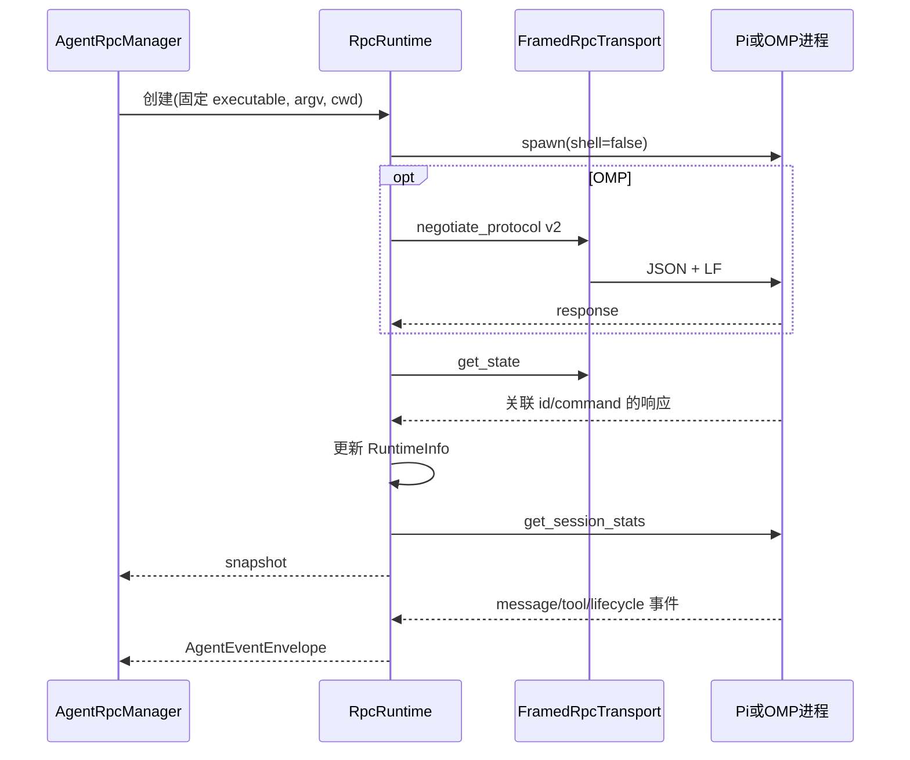

# 02 代理运行时与协议

[返回目录](README.md) · [上一章](01-architecture.md) · [下一章](03-data-and-projects.md)

## 1. 模块分工

| 文件 | 核心符号 | 责任 |
| --- | --- | --- |
| [harness.ts](../../electron/main/harness.ts) | `HarnessDescriptor`、`HARNESSES` | 引擎名称、路径、能力元数据 |
| [harness-discovery.ts](../../electron/main/harness-discovery.ts) | `HarnessDiscoveryService`、`probeHarnessExecutable` | 有界版本探测及刷新 |
| [process-utils.ts](../../electron/main/process-utils.ts) | `findHarnessExecutable`、`prepareExecutableSpawn` | 绝对路径发现、平台启动适配、进程环境 |
| [agent-rpc.ts](../../electron/main/agent-rpc.ts) | 对外导出入口 | 聚合 runtime 模块公开符号 |
| [manager.ts](../../electron/main/agent-rpc/manager.ts) | `AgentRpcManager` | 授权、模型验证、runtime 注册与回收 |
| [runtime.ts](../../electron/main/agent-rpc/runtime.ts) | `RpcRuntime` | 一个 CLI 子进程的请求、响应、状态和生命周期 |
| [transport.ts](../../electron/main/agent-rpc/transport.ts) | `FramedRpcTransport` | JSONL framing、stdin 排队及背压 |
| [harness-adapter.ts](../../electron/main/agent-rpc/harness-adapter.ts) | `HarnessRpcAdapter` | 参数、握手、命令和事件的协议差异 |
| [command-schema.ts](../../electron/main/agent-rpc/command-schema.ts) | `validateRpcCommand` | 命令白名单、字段、图片及会话路径验证 |
| [events.ts](../../electron/main/agent-rpc/events.ts) | `AgentEventForwarder` | 事件数量与字节预算，生命周期事件保留 |
| [context-usage.ts](../../electron/main/agent-rpc/context-usage.ts) | 上下文使用量辅助逻辑 | 归一化运行时上下文指标 |

## 2. 引擎发现

发现顺序由 descriptor 与 `process-utils.ts` 决定，大体为：设置中的绝对路径 → `PI_BINARY`/`OMP_BINARY` → 可选打包目录 → 进程 PATH → 官方安装位置及常见包管理器目录 → 有界 nvm 目录。

当前两个 descriptor 的 `bundledResourceDirs` 均为空，Ptx 不附带 Pi/OMP CLI。发现过程不执行 shell 启动脚本；每个候选需要通过可执行检查与受限 `--version` 探测。

`HarnessDiscoveryService.refresh()` 汇总路径、版本及 override 失败原因；失效的手动路径可回退到自动候选。`reconcileActiveHarness()` 在当前选择不可用时校准可用引擎。

Windows 有专门处理：

- OMP 检查 `%LOCALAPPDATA%/omp/omp.exe`。
- Pi 可识别受限的 npm `pi.cmd` 布局，并通过 `node.exe` 直接运行已验证的 CLI JS 入口，避免通用命令 shell。
- 原生 Windows 路径与 WSL 内部路径不是同一种执行环境，不会自动转换为 WSL transport。

## 3. Pi 与 OMP 差异

以下以当前 [适配器](../../electron/main/agent-rpc/harness-adapter.ts) 为准，旧集成文档中的 Prime 比较不属于现有支持。

| 事项 | Pi | OMP |
| --- | --- | --- |
| 启动 | `pi --mode rpc` | `omp --mode rpc --cwd <cwd>` |
| 子进程 cwd | 必须使用授权 cwd；无 `--cwd` 参数 | 同样使用授权 cwd，另传 `--cwd` |
| 恢复 | `--session <path>` | `--resume <path>` |
| 模型参数 | `--provider <provider> --model <id>` | `--model <provider>/<id>` |
| 推理强度 | `--thinking <level>` | `--thinking <level>` |
| 审批模式覆盖 | 不支持 | `--approval-mode always-ask/write/yolo` |
| 握手 | `get_state`，再刷新上下文统计 | 先协商协议 v2，再执行共享握手 |
| 分块帧 | 不启用 | 支持有界 base64 `rpc_chunk` 重组 |
| 分支命令 | 保持 `fork`、`get_fork_messages` | 转换为 `branch`、`get_branch_messages` |
| Fast mode | 私有 `/ptx-fast-mode` 命令及 provider hook | `set_fast_mode { enabled }` |
| 压缩事件 | 保持原事件 | `auto_compaction_*` 转换为 `compaction_*` |
| 非终结 `agent_end` | 直接按事件流处理 | `isTerminal === false` 被适配器过滤 |
| MCP | 依赖显式启用的 `pi-mcp-adapter` | 原生 MCP |

当前两种适配器均通过 `stripStreamingBehavior()` 去除 `prompt.streamingBehavior`，注释说明其兼容性仍待验证。因此 GUI 的 queue/steer 意图不能简单理解为该字段原样发送给 CLI。

两者都拒绝 Prime 专属 daemon/heartbeat/消息 RPC。Ptx 的跨会话协作使用独立 broker，不是被拒绝的 `send_message` 协议。

## 4. AgentRpcManager 的职责

### 4.1 启动

`start(raw)` 用于交互式入口，`startUnattended(raw)` 用于定时执行。两者进入 `startWithMode`：

1. 检查未关闭并解析可执行文件。
2. 只允许 `cwd/sessionPath/model/thinking/fast` 等已定义字段。
3. 调用注入的 `authorizeCwd` 和 session 路径验证器。
4. 经模型目录验证 model key、可见性和推理强度。
5. 构建 runtime 专属能力环境和适配器 argv。
6. `admitRuntime()` 串行化新进程接纳，创建 `RpcRuntime` 并登记。
7. 完成握手、模型能力装饰和可选 fast-mode 协商。
8. 通知 broker 绑定会话，返回 `RuntimeInfo`。

失败时停止已创建子进程并撤销能力环境，不保留半启动的 runtime 注册。

**当前并发规则：** 新 runtime 会尝试回收最早可安全停止的空闲 runtime；仍在运行、排队、压缩或启动中的 runtime 保留。管理器没有固定的“活动 runtime 最大数量”。不要把一次性工具进程池上限或 schedule 并发上限套用到这里。

### 4.2 命令

`command(runtimeId, rawCommand)` 先做共享 schema 验证，再做引擎翻译：

- `prompt/steer/follow_up` 再检查 MCP 认证命令策略。
- `set_model` 校验模型可选状态。
- `set_service_tier` 由 runtime 的专门方法接管。
- 图片请求检查 runtime 的图像输入能力。
- steer/follow-up 后补读状态，归一化队列信息。
- 更换模型/推理强度后刷新模型能力。

`runPromptToCompletion()` 是自动执行入口：发出 prompt 后观察忙碌状态，并有超时及 abort 处理。它证明的是运行流程结束，不证明测试通过或业务验收。

### 4.3 生命周期

`getForSession()` 查找可复用 runtime；`stopForSession()`、`stopForProjectRoots()`、`stopAll()` 按作用域回收。`requestRuntimeEnvironmentRefresh()` 增加环境 revision，停止旧配置的空闲进程，繁忙进程待空闲后退出，使下一次启动采用最新能力开关。

## 5. RpcRuntime 与传输

`RpcRuntime` 同时管理请求关联表、请求超时、退出状态、上下文刷新、压缩 watchdog、OMP chunk 组装及 Fast mode。`snapshot()` 返回浅冻结快照，嵌套状态采用整体替换，跨 IPC 由 Electron 克隆。

`FramedRpcTransport` 不承担业务授权。它负责严格 LF JSONL、写队列、背压、输入关闭及输出暂停。`StrictJsonlDecoder` 在 [jsonl.ts](../../electron/main/jsonl.ts) 处理跨 chunk 行与未分帧字节上限。

当前帧预算来自 [jsonl-limits.ts](../../electron/main/jsonl-limits.ts)：

| 通道 | 单条记录预算 |
| --- | ---: |
| 会话文件 JSONL | 64 MiB |
| RPC stdout 读取 | 16 MiB |
| RPC stdin 写入 | 2 MiB |

64 MiB 是文件记录解析上限，不是允许 UI 保留或显示同等大小正文；后面还有转录图、文本及图片显示限制。

### 5.1 事件保护

`AgentEventForwarder` 默认每秒接受 500 个普通事件、每个 envelope 不超过 8 MiB、总窗口不超过 32 MiB；关键生命周期有单独计数和预留字节，`runtime_exit` 去重并豁免速率计数限制，但仍需可序列化且符合单包大小约束。

丢弃事件产生 `transport_limit`，不是 `transport_error`。前者表示展示数据需要从只读转录重新对齐，不能直接把代理判为失败。

## 6. 模型目录

共同接口是 [ModelCatalogProvider](../../electron/main/model-catalog.ts)，基类是 [CliModelCatalogService](../../electron/main/model-catalog-cli.ts)：

- 30 秒 TTL，按 executable 隔离缓存。
- 多个并发刷新共享一次探测。
- 首次失败返回错误；已有成功缓存时可返回带警告的旧目录。
- 验证 provider/model ID、输入类型、上下文窗口、token 数等字段。
- GUI provider/model 禁用状态叠加在目录上，不修改 harness 凭证。

[OmpModelCatalogService](../../electron/main/providers-omp.ts) 执行 `omp models --json`；[PiModelCatalogService](../../electron/main/providers-pi.ts) 启动短生命周期 `pi --mode rpc --no-session --offline`，请求 `get_available_models` 后退出。

`validateModelEntry()` 把合法目录模型标为可选；CLI 目录不提供逐模型认证状态，所以 **`available: true` 不等于已认证或一定可成功调用**。

[model-selection.ts](../../electron/main/model-selection.ts) 的 `rankedModelMatches()`、`resolveModel()`、`resolveReasoning()` 服务于语音和协作创建等模糊选择场景；最终仍由 manager 验证准确选择。

## 7. 一条桌面消息的完整路径

1. [Composer](../../src/components/Composer.tsx) 收集正文、图片和上下文。
2. [useWorkspaceActions.sendPrompt](../../src/hooks/useWorkspaceActions.ts) 检查 workspace generation、项目和输入能力。
3. 无 runtime 时调用 `bridge.agent.start()`；已有 runtime 时判断忙碌状态。
4. 忙碌时纯文本 queue 通常先留在 renderer 队列，空闲后自动提交；steer 立即发送。部分已进入忙碌分支的消息使用 harness `follow_up`。
5. preload 调用 `agent:start` / `agent:command`，IPC 根据 harness 或 runtime 所有权路由。
6. manager 授权验证，adapter 翻译，runtime/transport 写入 CLI。
7. CLI 写自己的 JSONL，并产生实时事件。
8. 事件经主进程 sink 分发给任务、飞书和 renderer。
9. `useAgentEvents` 路由，`useWorkspaceRuntime` 批处理，`replayAgentEvents` 更新 transcript。
10. 终结事件、丢事件或目录变化触发只读转录对齐，纠正乐观 UI 与已持久化结果。

runtime ID 只标识当前子进程；session UUID/文件标识跨重启会话。恢复不能假设原 runtime ID 仍然有效。
