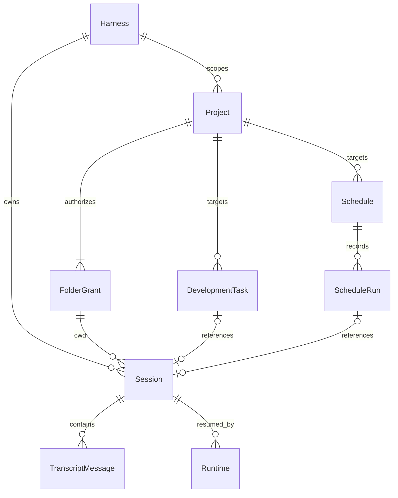

# 03 数据与项目授权

[返回目录](README.md) · [上一章](02-agent-runtime.md) · [下一章](04-renderer.md)

## 1. 数据所有权

Ptx 不使用 ORM 或应用数据库服务器，核心是有版本的 JSON 状态、只读 harness JSONL 和独立加密配置文件。

| 数据 | 所有者 | 位置/来源 | Ptx 行为 |
| --- | --- | --- | --- |
| 项目授权、设置、归档、调度 | Ptx | `userData/prime-work-state-v4.json` | 有界、串行、原子持久化 |
| 开发任务与模板 | Ptx | `userData/development-tasks.json` | 独立 schema v1 |
| 飞书配置、App Secret、回执、绑定 | Ptx | `userData/feishu.enc` | OS 安全存储加密 |
| 语音 key | Ptx | `userData/voice-secrets.json` | OS 安全存储加密；有条件支持仅本次进程内存使用 |
| 协作消息签名 key | Ptx | `userData/agent-message-signing.key` | 仅主进程读写 |
| 异常日志 | Ptx | `userData/crash.log` | 异常诊断 |
| Pi 会话 | Pi | `~/.pi/agent/sessions/<bucket>/*.jsonl` | 只读 |
| OMP 会话 | OMP | `~/.omp/agent/sessions/<bucket>/*.jsonl` | 只读 |
| Pi 模型账户 | Pi | `~/.pi/agent/auth.json` 等 | 不读取、不写入 |
| OMP 模型账户 | OMP | `~/.omp/agent/agent.db` | 不读取、不写入 |
| 浏览器配置文件 | Electron | `persist:prime-work-browser` 分区 | 与应用 renderer 隔离，可显式清理 |
| 输入草稿、注意状态、布局辅助状态 | Renderer | 对应 localStorage 键 | 非授权依据，不等同于业务记录 |

`userData` 来自 `app.getPath('userData')`，会随平台、应用名和测试隔离配置改变。不要把开发机路径写成所有安装通用的路径。

## 2. 核心实体

共同类型见 [api.ts](../../src/types/api.ts)。

| 实体 | 关键字段 | 含义 |
| --- | --- | --- |
| `ProjectRecord` | `id/harness/folders/primaryFolder/inferred/readOnly/hidden/scripts` | 一组同引擎目录及展示/脚本信息 |
| `PersistedProject` | `folderIdentities` | 额外保存目录稳定身份用于授权验证 |
| `SessionRecord` | `id/harness/filePath/projectPath/title/status/depth` | 目录摘要，不包含完整会话正文 |
| `RuntimeInfo` | `runtimeId/harness/cwd/sessionFile/isStreaming/isCompacting/model` | 活动 CLI 的快照 |
| `TranscriptMessage` | `id/role/parts/streaming/timestamp` | UI 归一化消息 |
| `MessagePart` | text、thinking、toolCall、toolResult、image、compaction 等 | 同一条消息中的异构内容 |
| `AppSettings` | `activeHarness/runtimePaths/locale/theme/...` | 应用配置，不含模型账户凭证 |
| `DevelopmentTask` | `goal/acceptance/model/status/sessionFile/history` | 目标驱动、需人验收的开发任务 |
| `AutomationScheduleRecord` | `harness/revision/target/timing/execution/runs` | 自动执行定义及有界历史 |



这是逻辑关联，不是数据库外键约束。关联有效性由每次服务操作重新验证，例如 session 是否仍属于目标引擎和工作目录。

## 3. JsonStateStore

源码：[store.ts](../../electron/main/store.ts)。

`DesktopState` schema v4 包含：

```text
version
projects
settings
archivedSessions
dismissedProjectPaths
schedules
```

主要方法：

| 符号 | 行为 |
| --- | --- |
| `openDesktopStateStore(userDataPath)` | 识别当前/旧状态路径，执行平台迁移，等待可写状态就绪 |
| `JsonStateStore.ready()` | 等待初始化并检查兼容性 |
| `snapshot()`、`getSettings()`、`getProjects()` | 返回克隆结果，不让调用者直接改内部状态 |
| `update(mutator)` | 串行队列中克隆草稿、执行修改、限制集合、持久化后发布内存状态 |
| `beginShutdown()` | 拒绝新写入，等待已有队列排空 |
| `defaultSettings()` | 提供应用默认设置 |

持久化采用临时文件、文件同步与原子替换。v4 迁移不仅是字段转换，还涉及授权不能被旧版本重新复活的兼容协议。

### 3.1 迁移与故障

- POSIX：写入并同步 v4，旧文件重命名为字节一致的迁移备份，并处理目录同步失败。
- Windows：使用字节一致备份和零授权旧版 marker，记录 pending/complete；不声称 Node 可以提供 POSIX 等价的目录项落盘保证。
- 更高 schema 或无法安全分类的超大状态：拒绝写入并保留原文件。
- 旧 Prime 或无法识别引擎的授权不分配给 Pi/OMP；清理旧数据前创建 `.removed-prime-*` 备份。
- 损坏状态有专门的保全/恢复流程，不能笼统认为所有异常都自动清空或都走同一策略。

相关错误类型是 `StateCompatibilityError`、`UnsupportedStateVersionError` 和 `StateMigrationError`。不要指导用户直接删除状态/备份文件来“修复”授权错误。

## 4. 项目是权限对象

源码：[ProjectService](../../electron/main/projects.ts)。

### 4.1 两种来源

**显式项目**：用户通过系统目录选择或确认授予访问。主进程记录规范化路径和 `FolderIdentity`，可用于代理、PTY、Git 写操作及配置变更。

**推断项目**：从 harness 会话目录发现。可显示历史会话，并支持授权范围内的只读文件、Git 状态等；实际执行前需要 `grantInferred()` 明确授权。

`hidden` 只是侧栏显示偏好，不是撤销权限。`remove()` 才执行移除、撤销与关联进程清理；它不意味着删除磁盘项目或会话 JSONL。

### 4.2 授权函数差异

| 方法 | 返回/保证 | 用例 |
| --- | --- | --- |
| `authorizePath(path)` | 现存路径在可读授权范围内 | 文件 reveal |
| `authorizeReadOnlyCwd(cwd)` | 可读目录，允许合规推断授权 | Git 状态、diff |
| `authorizeCwd(cwd)` | 有效显式可执行目录 | 代理、PTY、Git 修改 |
| `authorizeProjectRoot(path)` | 找到对应显式项目根 | 插件/配置写入 |

权限判断包含 realpath、路径包含关系、目录身份及广泛根限制。`/`、home 等过宽授权会被拒绝或隔离。目录身份使用 inode 和 birth time 等信息区分重挂载与目录替换，不仅比较字符串前缀。

### 4.3 Worktree 与项目脚本

`listWorktrees()` 通过 Git 工作树目录发现合法关联；`openWorktree()` 要求与有界 Git worktree 列表准确匹配；`createWorktree()` 使用系统保存对话框选择目标并验证 branch。新工作树作为原授权项目的额外目录保存，不是任意邻近目录自动获权。

`updateScripts()` 保存 setup/run；`markSetupStarted()` 和 `finishSetup()` 跟踪确切命令及退出状态。执行由前端 [ProjectRunControl](../../src/components/ProjectRunControl.tsx) 与 [TerminalDrawer](../../src/components/TerminalDrawer.tsx) 协调，实际 PTY 仍由主进程创建。

用户明确配置的终端脚本可以具有 shell 语义；不要将“内部 Git/package 命令无 shell 插值”误读成“终端不允许 shell 命令”。

## 5. 会话目录与增量元数据

入口：[sessions.ts](../../electron/main/sessions.ts)。

1. Pi/OMP 的 `*SessionServiceOptions()` 指定 session root、bucket 布局、元数据解析与转录读取器。
2. [SessionMetadataCatalog](../../electron/main/sessions/catalog.ts) 有界扫描文件，缓存元数据并协调已知变更。
3. [createIncrementalMetadataReader](../../electron/main/sessions/metadata.ts) 复用追加读取结果；根据文件状态与尾部校验判断是否需要重读。
4. [bucketed.ts](../../electron/main/sessions/bucketed.ts) 复用一层 bucket 发现、文件名时间戳和分支摘要处理。
5. `SessionService.list()` 合并磁盘元数据、Ptx 归档集合和 live runtime 状态。
6. `onDidChange()` 启用 watcher；变更经过合并，通知 renderer 刷新。

当前 Pi/OMP 没有额外的 live CLI 会话目录覆盖层，主要依据 JSONL 与 Ptx 自己管理的 runtime。

### 5.1 Pi / OMP 会话差异

| 内容 | Pi | OMP |
| --- | --- | --- |
| 会话树 | v3 `id/parentId` | v3 `id/parentId` |
| 标题 | 最新 `session_info.name` | title slot / 标题变更记录 |
| 模型变化 | `provider` 与 `modelId` | 单一 `provider/id` 字符串 |
| 标题占位 | 无 OMP 式固定 slot | 256 字节标题 slot |

`SessionService.list()` 当前按 `lastUserMessageAt ?? createdAt` 排序，不是简单按文件 mtime。显示和状态来源需要结合实时事件判断。

## 6. 转录读取

[createTranscriptReader](../../electron/main/sessions/transcript.ts) 根据 JSONL 中的树形关系整理有效分支，并将消息、工具、思考、压缩与图片映射到 `TranscriptMessage[]`。它不是把所有 JSONL 行依次打印出来。

`SessionService.read()`：

- 首先验证 session root 与规范化文件路径。
- 对同一文件的并发读进行合并，并限制整体读取并发。
- 结合 runtime 是否忙碌判断流式状态。
- 返回有界的只读结果；IPC 边界负责跨进程复制。

`rename()` 仅调用活动 runtime 的 `set_session_name`；离线不会重写 JSONL。`archive()` 将路径写入 Ptx 的归档集合并停止关联 runtime；归档不会删改转录文件。

### 6.1 尚未落盘的新会话

飞书 `/新建` 可能拿到 session UUID/path，但 harness 尚未生成 JSONL。`registerPendingSession()` 允许主进程在验证路径、harness 和活跃 runtime 后登记内存占位：

- 侧栏可发现新会话，读取返回空消息。
- 已落盘文件出现后由正常目录替换。
- runtime 退出时清理。
- 通用文件路径授权器仍要求真实文件，不因此放宽终端等其他消费者的权限。

它不是虚构并写入一个会话 JSONL，也不保证未落盘空会话跨应用重启保存。

## 7. 调试数据问题的顺序

1. 确认实体属于哪个 harness，区分 project ID、session UUID、file path 和 runtime ID。
2. 区分 UI 的实时状态、目录快照和真实转录，不把 `idle` 覆盖规则误认为磁盘数据损坏。
3. 若授权失败，先核对显式 grant、realpath、目录身份和被撤销/隐藏状态。
4. 若会话出现但正文打不开，检查帧大小、转录限制和当前分支解析。
5. 若重启状态异常，保留所有迁移备份/marker，按状态版本和操作系统定位。
