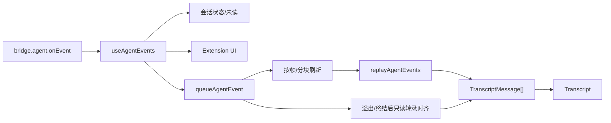

# 04 前端与状态管理

[返回目录](README.md) · [上一章](03-data-and-projects.md) · [下一章](05-capabilities.md)

## 1. 入口与布局

[src/main.tsx](../../src/main.tsx) 创建 React root，使用 `StrictMode` 和顶层 `ErrorBoundary`。错误边界调用 `saveComposerDraftFromDom` 保留输入草稿，再提供重新加载入口。

[App.tsx](../../src/App.tsx) 是 UI 组合根，连接设置、工作区、页面、侧栏、聊天和面板。页面切换使用 `WorkspaceView`，不是独立的 React Router 路由系统。

```text
App
  TitleToolbar / AppUpdateButton
  Sidebar
  当前 WorkspaceView
    session: ConversationHeader + Transcript + Composer
    projects: ProjectsPage
    activity: ActivityPage
    tasks: TasksPage
    scheduled: ScheduledPage
    plugins: PluginsPage
    settings: SettingsPage
  Inspector
    SummaryPanel / ChangesPanel / BrowserPanel / FilesPanel
  TerminalDrawer
  AgentBrowserLayer
  CommandPalette / ExtensionUiModal / VoiceOrb / DesktopPet
```

`Transcript`、`Inspector`、终端和主要页面使用 `lazy()` / `Suspense` 按需加载。`AgentBrowserLayer` 在独立承载层保留 agent tab，检查面板提供可见的 browser slot，避免简单切面板就破坏网页生命周期。

没有 `window.ptx` 时，App 使用 [data.ts](../../src/lib/data.ts) 中的示例数据及模拟事件。这是 UI 演示路径，不是可执行真实项目任务的浏览器版后端。

## 2. 状态组织

项目主要使用 React state、ref 和自定义 hooks，没有引入 Redux、Zustand 或统一远程查询库。状态按生命周期拆分：

| Hook/模块 | 核心职责 |
| --- | --- |
| [useAppSettings](../../src/hooks/useAppSettings.ts) | 读取、更新并协调应用设置 |
| [useHarnessWorkspace](../../src/hooks/useHarnessWorkspace.ts) | 当前引擎 bootstrap 与可执行文件刷新 |
| [useBootstrap](../../src/hooks/useBootstrap.ts) | 初始目录、运行时和调度读取，订阅 session 变化 |
| [useWorkspaceRuntime](../../src/hooks/useWorkspaceRuntime.ts) | 当前工作区、runtime 绑定、消息、队列和转录读取 |
| [useWorkspaceActions](../../src/hooks/useWorkspaceActions.ts) | 选择、启动、发送、停止、项目及能力操作 |
| [useAgentEvents](../../src/hooks/useAgentEvents.ts) | runtime 事件到当前 UI/会话目录的路由 |
| [useProviderCatalog](../../src/hooks/useProviderCatalog.ts) | 模型、provider、推理强度与 fast-mode 选择 |
| [useExtensionUi](../../src/hooks/useExtensionUi.ts) | 扩展选择、确认、输入及问卷对话框 |
| [usePanelLayout](../../src/hooks/usePanelLayout.ts) | 面板宽高、拖动、窄窗口 overlay 行为 |
| [useTurnChanges](../../src/hooks/useTurnChanges.ts) | 按回合记录变化展示，并绑定回合锚点 |
| [useTaskSessionNavigation](../../src/hooks/useTaskSessionNavigation.ts) | 跨引擎打开任务关联会话，等待目标项目目录可用 |

辅助 hooks 管理 toast、导航历史、图片输入、技能列表、侧栏动作、浏览器注释、agent tabs 和应用更新。

## 3. Workspace Generation

[WorkspaceSnapshot](../../src/app/workspace.ts) 包含：

```text
generation
project
session
cwd
sessionFile
```

`useWorkspaceRuntime.activateWorkspace()` 在切项目/会话时递增 generation，重置当前 runtime、消息读取等上下文。异步请求发起时捕获 generation，完成时必须检查仍属于当前工作区。

关键保护：

- `runtimeOwnerRef` 把 runtime ID 与 generation 绑定。
- `runtimeSessionsRef` 保存 runtime 到 session 文件的映射。
- [createScopedRequestGuard](../../src/app/scoped-request.ts) 同时比较请求 ID、generation 和路径，阻止旧响应覆盖新页面。
- harness 切换先清空可见目录并切换 generation，再读取目标引擎。
- 发送消息使用选中项目自身的 `harness`，不只读取全局 settings，避免切换瞬间将新引擎送到旧目录。

**切换引擎不会主动停止另一个引擎正在执行的任务。** 它改变前端活动视图与当前绑定；后台 runtime 仍可继续，由全局事件目录记录状态。

## 4. 前端 Bootstrap

`useBootstrap()` 等待设置选择确定后，并行读取项目、会话和 runtime，同时请求元数据和 schedule。

项目/会话通过 `Promise.allSettled` 处理部分失败，runtime 读取不阻塞初始工作区显示。迟到的 runtime 只能附加到当初选中的 generation/session。

`mergeSessionCatalog()` 合并目录快照时保留 renderer 已知的生命周期状态与注意 revision。例如有未完成扩展弹窗的 `waiting` 不能被一个不知道弹窗的磁盘目录 `idle` 覆盖。

目录变化采用短时合并，只给真正变化的会话推进同步 revision，降低全部聊天重复加载。

## 5. 实时事件到聊天



[src/lib/events/](../../src/lib/events/) 将解析、ID、压缩与 reducer 分离：

- `parse.ts` 解析未知事件及内容。
- `ids.ts` 生成稳定消息/内容标识。
- `compaction.ts` 处理压缩显示。
- `reduce.ts` 的 `replayAgentEvents()` 合并一批消息、工具、思考、错误和生命周期事件。

`useWorkspaceRuntime` 通过 `requestAnimationFrame` 合并更新；积压时分块处理。[agent-events.ts](../../src/app/agent-events.ts) 当前队列上限为 50,000，分块大小为 2,000。达到限制后标记需要转录对齐，不能只丢弃数据后声称 UI 完整。

### 5.1 实时事件与磁盘快照协调

- [runTranscriptRead](../../src/app/transcript-load.ts) 统一异步读成功、失败和结束回调。
- `authoritativeTranscriptReadIsCurrent()` 防止旧磁盘结果覆盖新 prompt。
- `reconcileTranscriptMessages()` 保留尚未持久化的本地尾部消息并消除对应重复。
- [reconcileTranscripts](../../src/app/transcript-reconcile.ts) 对未变化消息复用对象引用，减少重渲染。
- `transport_limit`、runtime 退出、回合结束等会触发适当的重新对齐。

不能在每个 token 到来时重新读取整个 JSONL，也不能永久只信任 renderer 的乐观消息。

## 6. 消息输入与排队

[Composer](../../src/components/Composer.tsx) 组合文本、图片、会话 mention、能力 mention、浏览器标注和终端选择上下文。附加内容的格式辅助位于 `src/lib/`。

`sendPrompt()` 有单次接纳机制与 generation 校验，主要分支：

| 情况 | 行为 |
| --- | --- |
| 空闲，无 runtime | 检查授权与模型，启动后发送 prompt |
| 空闲，有 runtime | 发送 prompt，乐观追加 UI 消息 |
| 忙碌，纯文本 queue | 暂存 renderer 队列，空闲后冲刷 |
| 忙碌，steer | 直接发 `steer`，显示已接纳/已读取进度 |
| 已进入运行中投递分支 | 可发 `follow_up`，交给 harness 队列 |
| 异步等待期间切换 workspace | 拒绝迟到 UI 写入，必要时停止本次新建 runtime |

快捷键与用户偏好由 [message-shortcuts.ts](../../src/lib/message-shortcuts.ts)、[app-shortcuts.ts](../../src/lib/app-shortcuts.ts) 管理。queue/steer 快捷键可交换，不应在组件里假定永远固定。

## 7. 关键组件

| 组件 | 职责与依赖 |
| --- | --- |
| [Transcript](../../src/components/Transcript.tsx) | 合并相邻 assistant 消息，选择角色组件，呈现回合变化卡片 |
| [MarkdownText](../../src/components/MarkdownText.tsx) | Markdown/GFM、安全链接、代码复制、文本方向与流式解析节流 |
| [transcript/messages.tsx](../../src/components/transcript/messages.tsx) | 用户、助手、协作消息与活动消息展示 |
| [transcript/timeline.tsx](../../src/components/transcript/timeline.tsx) | 工具分类、工作时长、思考/工具折叠时间线 |
| [transcript/scroll.ts](../../src/components/transcript/scroll.ts) | 最近消息窗口、向前展开、贴底和滚动状态 |
| [ModelPicker](../../src/components/ModelPicker.tsx) | 模型与供应商检索选择 |
| [TerminalDrawer](../../src/components/TerminalDrawer.tsx) | xterm 实例、多个 PTY 标签、尺寸适配和选区上下文 |
| [ChangesPanel](../../src/components/inspector/ChangesPanel.tsx) | Git 状态、diff、暂存、提交及相关操作 |
| [FilesPanel](../../src/components/inspector/FilesPanel.tsx) | 有界文件树与 reveal |
| [ExtensionUiModal](../../src/components/ExtensionUiModal.tsx) | CLI 扩展交互与审批问答 |
| [CommandPalette](../../src/components/CommandPalette.tsx) | 搜索导航及常用动作 |

## 8. 渲染性能与安全

- `MarkdownText` 流式解析默认按 100ms 或换行推进，避免逐字符重解析整个 Markdown。
- 长转录先显示最近窗口，再由用户加载更早消息，不直接将所有历史挂入 DOM。
- [render-bounds.ts](../../src/lib/render-bounds.ts) 提供 `newestWindow`、`boundText`、`boundLines`。
- 不启用模型 Markdown 原始 HTML，不自动加载模型给出的远程图片。
- 错误边界隔离组件错误；异步错误通过可见 toast/错误内容或日志呈现。
- 独立 vendor chunks 与页面 lazy import 配合包体积门禁。

## 9. 样式与国际化

[styles.css](../../src/styles.css) 按顺序引入各 surface CSS；[base.css](../../src/styles/base.css) 保存主题 token，组件使用语义 class 和 CSS 变量。当前没有采用 Tailwind；历史 token-framework 方案已推迟。

[I18nProvider](../../src/lib/i18n/index.tsx) 与 [runtime.ts](../../src/lib/i18n/runtime.ts) 解析 `system/en/zh-CN`，词条按 shell、chat、settings、tasks 等拆分到 catalogs。原生菜单使用主进程 [ui-locale.ts](../../electron/main/ui-locale.ts)。

界面文字缩放当前通过 Electron window 的 `zoomFactor` 实现，不能将历史 CSS 指南中的 token 迁移触发条件当作已采用的方案。新增页面需同时检查中英文词条、主题 token、窄窗口布局及键盘操作。
