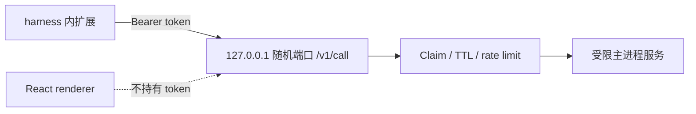

# 05 本地工具与能力扩展

[返回目录](README.md) · [上一章](04-renderer.md) · [下一章](06-tasks-and-schedules.md)

## 1. 功能分层

Ptx 的“能力”既包括桌面本地工具，也包括加载到 harness 的扩展。它们共享 GUI，但执行入口和权限不同：

| 类型 | 执行位置 | 入口 |
| --- | --- | --- |
| Git/项目文件 | 主进程调用固定工具或只读文件接口 | `window.ptx.git/projects` |
| 交互终端 | 主进程拥有 PTY，renderer 显示 xterm | `window.ptx.terminal` |
| 内嵌浏览器 | 独立 webview guest，由主进程控制 | renderer tab API + agent broker |
| Plugin/Package | Pi/OMP CLI 安装与执行 | `PluginService` |
| Extension | harness 加载的 JS/TS 模块 | `assets/extensions/` 或 native 扩展目录 |
| Skill | 模型侧文字指南或配套客户端 | `assets/skills/`、harness 技能目录 |
| MCP | harness/adapter 加载的连接定义 | 仅受支持的本地 stdio 管理由 Ptx 写入 |
| 会话协作 | 主进程 broker 路由到已有 manager | `session_*` 扩展工具 |

第三方工具使用用户 OS 权限运行。Electron renderer 沙箱不是对用户主动启动的所有工具的 OS 沙箱。

## 2. Git

源码：[git.ts](../../electron/main/git.ts)，主类 `GitService`。

| 方法 | 含义 |
| --- | --- |
| `branch()`、`branches()`、`status()` | 分支与状态读取 |
| `diff(cwd,path,staged)` | 有界工作区或暂存 diff |
| `stage()`、`unstage()`、`restore()` | 显式写授权下修改索引/工作区 |
| `commit()` | 使用输入提交消息创建提交 |
| `push()`、`pull()` | 受限配置与传输检查后执行同步 |
| `aheadCommits()`、`undoCommit()` | 查看待推送提交、执行相应撤销操作 |
| `switchBranch()`、`createBranch()` | 分支切换与创建 |

`listGitWorktrees`、`validateGitBranch`、`createGitWorktree` 是供项目服务使用的独立辅助函数。

主要约束：

- 读操作和写操作使用不同授权回调。
- `restrictedGitEnvironment` 与内部检查限制危险 Git 配置、外部 helper、filter、hooks 等执行面，具体允许条件见源码及 `git-guards` 测试。
- 内部命令使用 argv，不拼接用户输入到 shell。
- 当前状态条目预算为 1,000，diff 行预算为 5,000。
- Git 结果是当前工作目录状态，不一定只对应当前聊天或任务。

## 3. 终端

[TerminalService](../../electron/main/terminal.ts) 通过 `node-pty` 管理子进程。[TerminalDrawer](../../src/components/TerminalDrawer.tsx) 使用 `@xterm/xterm`、fit 和 web-links 插件进行展示。

生命周期：

1. renderer 请求 `create({cwd,...})`，主进程验证目录和 shell。
2. 返回不透明 `terminalId`，绑定创建它的 WebContents owner。
3. 输入/尺寸通过固定事件通道发送，输出和 exit 事件回推。
4. `bindSession()` 将终端关联到已验证会话。
5. `setActiveContext()` / `readActive()` 为 agent 浏览器扩展提供当前会话的只读终端上下文。
6. owner 销毁、会话归档、项目移除或应用退出时，按范围关闭终端及后代。

`input()`/`resize()`/`kill()` 都检查 owner。不能凭别的窗口或猜测的 ID 操作任意 PTY。终端流会合并并限制字节，renderer 不是原始进程句柄的持有者。

## 4. 浏览器

| 文件 | 关键职责 |
| --- | --- |
| [browser/agent-service.ts](../../electron/main/browser/agent-service.ts) | `AgentBrowserService`：主进程 tab 状态、guest 绑定、输入串行化 |
| [browser/agent-bridge.ts](../../electron/main/browser/agent-bridge.ts) | `AgentBrowserBridge`：runtime token 到会话 tab/终端的受限操作 |
| [browser/page-scripts.ts](../../electron/main/browser/page-scripts.ts) | DOM 摘要、元素 ref、坐标与页面脚本 |
| [browser-downloads.ts](../../electron/main/browser-downloads.ts) | `BrowserDownloadGuard`：下载准入、路径与预算 |
| [AgentBrowserLayer.tsx](../../src/components/AgentBrowserLayer.tsx) | webview guest 承载与布局 |
| [BrowserPanel.tsx](../../src/components/inspector/BrowserPanel.tsx) | URL、导航、标签和预览控件 |

`approveGuest()` 只接收通过 `will-attach-webview` 安全门禁的 guest；`attachTab()` 再把其 WebContents ID 绑定到主进程注册的 tab。

代理工具可进行 `openTab/listTabs/navigate/readPage/screenshot/click/type/pressKey/scroll/evaluate` 等操作。`evaluate` 运行在目标远程页面上下文，不是把任意代码交给 Electron 主进程执行。

### 4.1 权限与限制

- guest 使用 `persist:prime-work-browser`，禁用 Node、preload、子 guest 与任意权限。
- URL、重定向和 frame 导航限定为无 URL 凭证的 HTTP(S)；初始空白页有明确处理。
- Agent tab/终端读取范围绑定当前 session，不因知道其他 tab ID 自动扩权。
- 返回页面和终端内容标记为不可信输入。
- 下载要求用户手势，限制单文件 512 MiB、同时 3 个、每小时 1 GiB。
- 关闭 guest、清理浏览器数据和应用退出会取消相关下载。
- 关闭下载保存提示后，使用 OS Downloads 下消歧后的安全文件名，不是任意覆盖同名文件。

### 4.2 页面标注

[useBrowserAnnotations](../../src/hooks/useBrowserAnnotations.ts)、[browser-annotations.ts](../../src/lib/browser-annotations.ts) 与 [annotation-picker.ts](../../src/lib/annotation-picker.ts) 将元素信息、几何位置及用户说明组织为下一条 prompt 的上下文。这和 agent 直接操作 tab 是两条互补路径。

## 5. CapabilityBridge

[CapabilityBridge](../../electron/main/lib/capability-bridge.ts) 是调度、浏览器、协作 broker 的抽象基类。

`start()` 监听随机 loopback 端口；`environmentFor(scope)` 生成随机 token，并注入子进程环境；`revoke()` 和 `stop()` 撤销 claims。

`CapabilityClaim` 带 cwd、可选 sessionPath/harness、到期时间和限流窗口。请求必须为固定路径的 POST，包含正确 Bearer token；带 `Origin` 的请求被拒绝。当前 body 读取字节上限是 1,100,000，token TTL 为 24 小时，子类定义每分钟调用上限。

注意：这里依据实际实现描述方法、路径、Origin、token、body 大小和 JSON 解析；不能仅依据历史安全文字声称基类额外校验了 `Content-Type`。

此服务只供同机 scoped runtime 使用，不是应用公开远程 REST API。飞书使用主动出站 SDK，和该 loopback 服务无关。

## 6. 内置扩展

统一元数据见 [extension-manifest.ts](../../electron/main/extension-manifest.ts)，启动注入见主进程 `extensionRuntimeEnvironment()`。

| 文件 | 用途 | 启用条件 |
| --- | --- | --- |
| [omp-work-schedules.ts](../../assets/extensions/omp-work-schedules.ts) | 创建/管理 Ptx schedule | Pi、OMP 共享 |
| [omp-work-browser.ts](../../assets/extensions/omp-work-browser.ts) | browser 操作及当前终端只读上下文 | 浏览器能力开启 |
| [omp-work-collaboration.ts](../../assets/extensions/omp-work-collaboration.ts) | `session_*` 跨会话工具 | Pi、OMP 共享 |
| [omp-work-ask-user.ts](../../assets/extensions/omp-work-ask-user.ts) | 原生问卷/交互请求 | 默认关闭，交互 runtime 才注入 |
| [pi-work-fast-mode.ts](../../assets/extensions/pi-work-fast-mode.ts) | Pi 私有快模式命令与 provider hook | Pi runtime |

`omp-work-*` 文件名被 Pi 复用是当前设计，并不代表 Pi 错用了 OMP 专属进程。

Computer Use 单独通过 [CuaDriverService](../../electron/main/cua-driver.ts) 探测已安装的 TryCUA driver，默认关闭。启用后注入 driver 绝对路径和指南，不自动安装 driver，也不通过该开关创建 MCP 配置。

## 7. 插件、包与 MCP

主入口：[PluginService](../../electron/main/plugins.ts)。

| 子模块 | 职责 |
| --- | --- |
| [catalog.ts](../../electron/main/plugins/catalog.ts) | 能力根目录发现、技能/扩展/包/MCP 归一化及警告 |
| [package-execution.ts](../../electron/main/plugins/package-execution.ts) | 来源验证、Pi/OMP 安装/移除命令 |
| [extension-installation.ts](../../electron/main/plugins/extension-installation.ts) | 独立本地 JS/TS 扩展安装与目标目录校验 |
| [mcp.ts](../../electron/main/plugins/mcp.ts) | MCP schema、状态、锁、fingerprint、原子配置更新 |
| [mcp-probe.ts](../../electron/main/plugins/mcp-probe.ts) | 有界 stdio MCP 探测及进程清理 |
| [file-io.ts](../../electron/main/plugins/file-io.ts) | 有界文件读取 |

安装差异：

- OMP plugin 经 `omp plugin install <source> --json`。
- Pi package 经 `pi install <source>`；项目范围使用对应本地选项。
- OMP 独立扩展可复制到 native 目录，已有文件不直接覆盖。
- 来源接受合规 registry spec、本地绝对路径和 HTTPS/SSH；plain HTTP 仅 loopback，`git://` 拒绝。

MCP 定义写入：

| 引擎 | 全局 | 项目 |
| --- | --- | --- |
| OMP | `~/.omp/agent/mcp.json` | `<project>/.omp/mcp.json` |
| Pi | `~/.pi/agent/mcp.json` | `<project>/.pi/mcp.json` |

Pi 只有启用规范的 `npm:pi-mcp-adapter` 来源时才能创建/启用/停用连接，停用 adapter 后仍可删除定义以清理。相似名称、scoped/Git/local 来源不能替代该准入条件。

Ptx 只管理 **本地 stdio**。HTTP/SSE/含 URL 的定义保持外部管理；可展示和做有界定义删除，不替 harness 执行认证。`/mcp-auth`、`/mcp reauth` 等认证操作在应用入口被拒绝。

写入使用合作锁、fingerprint 重试、目录身份检查与原子替换；这不是 OS 级 compare-and-swap，忽略锁的同用户程序仍可能与最终 rename 竞争。

## 8. 顶层会话协作

[AgentCollaborationBridge](../../electron/main/collaboration/agent-bridge.ts) 提供：

| 工具 | 语义 |
| --- | --- |
| `session_list` | 列出可访问的同范围会话 |
| `session_models` | 当前引擎及 GUI 可见模型 |
| `session_create` | 在同 cwd 创建并立即 prompt 顶层会话 |
| `session_read` | 读取有界的最近对话摘要 |
| `session_send` | 发送带来源归属的消息，必要时正常恢复目标 runtime |
| `session_wait` | 有界等待目标闲置及新上下文 |

scope 必须是 **相同 harness + 相同 canonical cwd**，排除调用者自身、归档及非顶层会话。一个 project 含多个 folder 不代表可以跨 folder 协作。

读取最多 40 条对话消息和约 30,000 token 估计，省略工具内部内容；send 上限 64 KiB；wait 上限 30 秒。它不是无限阻塞或跨项目消息总线。

`@session` 标题由 renderer 解析为稳定 UUID，模型侧路由块从显示转录剥离。主进程用 [message-envelope.ts](../../electron/main/collaboration/message-envelope.ts) 的 `encodePtxAgentMessage` / `parsePtxAgentMessage` 做 HMAC 封装验证，防止普通用户文本冒充受信任 agent 消息。
