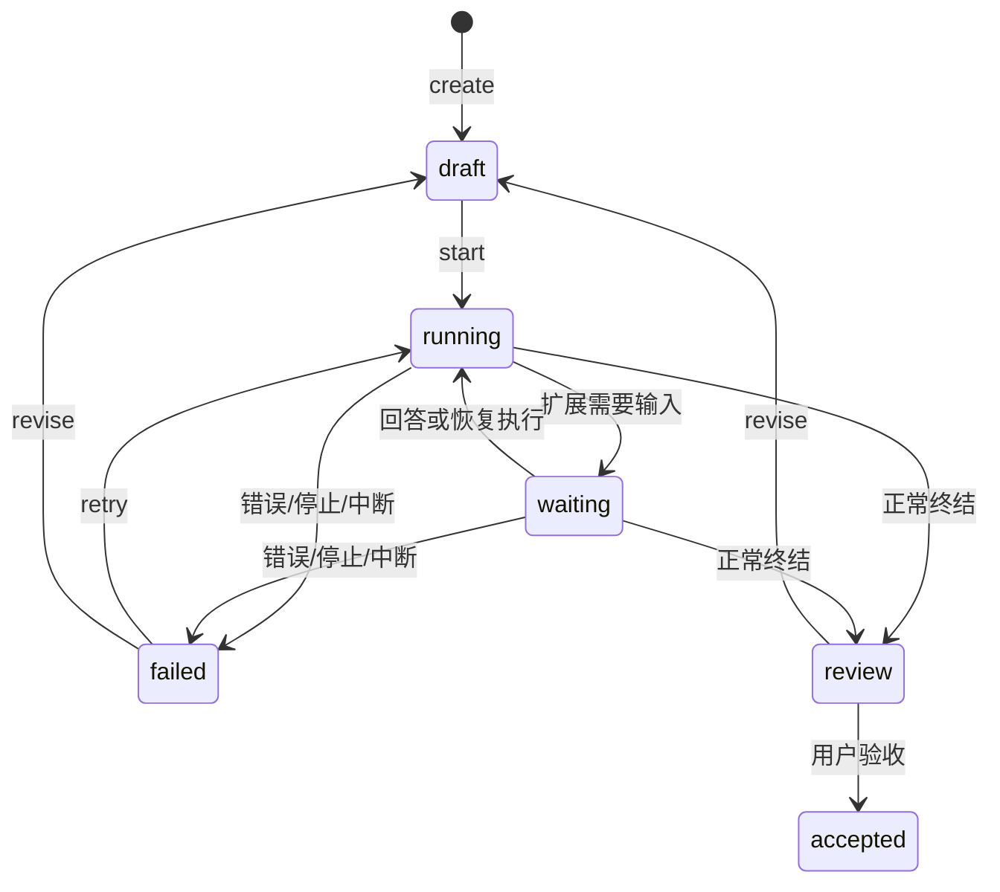
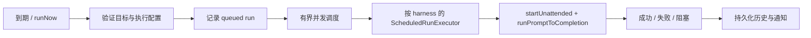

# 06 任务与定时执行

[返回目录](README.md) · [上一章](05-capabilities.md) · [下一章](07-feishu-and-voice.md)

## 1. 不同的三个概念

| 概念 | 所属模块 | 目的 | 是否跨重启持久化 |
| --- | --- | --- | --- |
| 聊天 queue/steer | renderer + harness runtime | 当前会话中的下一条消息/方向调整 | Ptx 不承诺重放未执行队列 |
| 开发任务 Task | `TaskService` | 目标、验收要求、执行与人工确认 | 元数据/状态/模板持久化 |
| 定时执行 Schedule | `AutomationService` | 按一次性时间或 RRULE 自动启动工作 | 定义及有界执行历史持久化 |

飞书的 `/任务` 当前只是普通持续会话消息兼容写法，不会自动创建 `DevelopmentTask`。

## 2. 开发任务

入口：

- 主进程：[tasks/service.ts](../../electron/main/tasks/service.ts)。
- 类型：[tasks.ts](../../src/types/tasks.ts)。
- UI：[TasksPage](../../src/pages/TasksPage.tsx)、[TaskForm](../../src/pages/tasks/TaskForm.tsx)、[TaskDetail](../../src/pages/tasks/TaskDetail.tsx)。
- IPC：`tasks:*`。

### 2.1 状态机



UI 对应“待开始、运行中、待确认、待验收、失败、已验收”。`accepted` 不由 AI 文本或工具退出码自动触发。

### 2.2 关键方法

| 方法 | 输入/输出与规则 |
| --- | --- |
| `create(raw)` | 验证 `TaskInput`，授权 cwd，创建 draft 并返回克隆记录 |
| `start(id)` | 仅 draft/failed 可启动，检查并发与模型/会话，调用正常 manager |
| `onAgentEvent(envelope)` | 根据 runtimeId 更新 running/waiting/review/failed |
| `stop(id)` | 关闭 runtime，记为 failed，保留上下文供复查 |
| `accept(id)` | 仅 review 且 runtime 不忙时人工变为 accepted |
| `revise(id,instructions)` | 将修改说明追加到目标，恢复 draft |
| `evidence(id)` | 重新授权，读取关联会话和当前 Git 状态 |
| `templates/saveTemplate/deleteTemplate` | 本地模板库 |

### 2.3 启动调用链

```text
TaskForm / TaskDetail
  -> window.ptx.tasks.create/start
  -> ipc.ts
  -> TaskService.authorize
  -> 检查任务锁、冲突 cwd、活动 runtime
  -> harness.agents.start({cwd, model, thinking, sessionPath?})
  -> 保存 runtime/session 引用
  -> agents.command(prompt: title + goal + acceptance)
  -> onAgentEvent
  -> review 或 failed
```

`start()` 返回的是已启动的任务记录，不等待整个模型任务完成。后台 prompt promise 的失败会更新失败状态并停止对应 runtime。

### 2.4 并发与恢复

- 同任务使用启动锁，避免重复点击。
- 检查同目录及父子目录的其他 active task。
- 检查两种引擎已有 streaming/compacting runtime 的目录冲突。
- 独立 worktree 可以隔离代码修改；外部编辑器和终端不受任务锁控制。
- 重试复用原 session 时重新校验归属。
- 应用重启将遗留 running/waiting 标为 failed，并说明执行中断，不自动重跑。

这里是应用层冲突控制，不应描述成覆盖所有外部文件写入或所有潜在并发窗口的 OS 文件锁。

### 2.5 验收证据

`TaskEvidence` 返回 `{capturedAt, git, messages}`。它是“读取时工作区状态 + 关联会话记录”，不是任务专属的冻结 diff：

- 同目录的外部修改可能被包含。
- 已提交修改可能不在当前工作区状态里。
- 重试使用原会话，证据包含更早回合。
- 没有工具错误不代表用户验收通过。
- 证据读取错误应显示错误，不能等价为空白成功。

### 2.6 存储

`development-tasks.json` schema v1；最多 500 个任务、100 个模板、单任务 200 条状态历史，总文件上限 16 MiB。采用私有权限临时文件、fsync、rename，失败回滚内存到最近 durable 状态。

未知版本/损坏文件保留原样，并在任务功能报错；不会用空任务覆盖，也不会阻止基本聊天启动。

## 3. Schedule 数据与入口

主进程：

- [service.ts](../../electron/main/schedules/service.ts)：`AutomationService`。
- [executor.ts](../../electron/main/schedules/executor.ts)：`ScheduledRunExecutor`。
- [recurrence.ts](../../electron/main/schedules/recurrence.ts)：时间校验与下一次执行。
- [retention.ts](../../electron/main/schedules/retention.ts)：历史限制。
- [notifications.ts](../../electron/main/schedules/notifications.ts)：失败/阻塞通知。
- [agent-bridge.ts](../../electron/main/schedules/agent-bridge.ts)：代理侧受限管理。

UI 是 [ScheduledPage](../../src/pages/ScheduledPage.tsx)。用户和 agent 都使用同一调度服务；agent 入口额外限定当前 runtime 的 project/session scope。

### 3.1 两套状态

定义状态 `ScheduleDefinitionStatus`：

- `active`：等待到期。
- `paused`：用户暂停。
- `completed`：没有后续 occurrence。
- `blocked`：授权/配置等问题导致阻塞。

一次运行 `ScheduleRunStatus`：

`queued → running → succeeded/failed`，也可能为 `skipped/interrupted/cancelled`。

不要把 schedule 定义 `completed` 等同于某次模型输出已被人验收。

### 3.2 输入模型

```text
target:
  project(projectId)
  或 session(projectId, sessionId)

timing:
  once(at)
  或 rrule(dtstartLocal, timeZone, rrule)

execution:
  model: auto 或精确 model key
  thinking: auto 或支持的推理级别
  speed: normal 或 fast
```

`revision` 用于编辑冲突/运行定义版本识别；run 保存触发类型、计划时间、实际时间、执行配置、session 引用与失败原因。

## 4. Schedule 生命周期

`AutomationService.start()`：

1. 将旧进程遗留的 queued/running run 记为 interrupted。
2. 验证持久化 active prompt，禁止的 MCP 认证指令进入 blocked。
3. 将超过容忍窗口的错过 occurrence 记为 skipped，而不是批量补跑。
4. 为最近的下一次时间设 timer。

运行时：



`nextScheduleOccurrence()`、`previewScheduleOccurrences()` 与 `countMissedOccurrences()` 使用 RRULE 和时区规则，不应替换为简单固定毫秒间隔。

## 5. ScheduledRunExecutor

每个 harness 一个执行器：

- `validateTarget()` 检查显式项目、目录和 session 所属关系，归档会话不得执行。
- `validateExecution()` 校验精确模型、推理级别和 Fast mode；`auto` 保留继承语义。
- `run()` 先做 prompt 策略检查，再解析目标。
- 新会话用 `startUnattended()`，完成后在 `finally` 停止 runtime。
- 会话目标使用 `sessionTails` 串行化本执行器对此 session 的运行；若已有 runtime，等待其空闲后停止并以 unattended 恢复。
- unattended runtime 不注入会阻塞 UI 的 Ask User；这不是所有第三方能力都无法产生交互的绝对保证。

默认等待已有 session 空闲最多 15 分钟；manager 默认 prompt 完成等待为 30 分钟。配置与业务验证失败使用 `ScheduleBlockedError` 区分。

## 6. 重试与历史预算

当前 [service.ts](../../electron/main/schedules/service.ts) 常量：

| 项目 | 值 |
| --- | ---: |
| Schedule 定义总数 | 500 |
| 调度并发运行 | 2 |
| 到期容忍窗口 | 60 秒 |
| 自动重试次数 | 2 |
| 重试延迟 | 5 分钟、20 分钟 |
| 连续终结失败阈值 | 3 |

配置阻塞不自动重试；其他失败在预算内退避重试。重试链仅在当前进程存活期内尽力执行，重启不会盲目重放。

[retention.ts](../../electron/main/schedules/retention.ts) 默认每个 schedule 最多 50 条运行历史，全局 2,000 条。更改预算要同步验证持久化与 UI。

## 7. 运行前提

Schedule 依赖 Ptx 进程和机器可运行，不能保证关机或休眠期间准时执行。macOS 可选择后台菜单栏和登录启动，但这不是独立系统守护进程，也不是云端调度平台。
