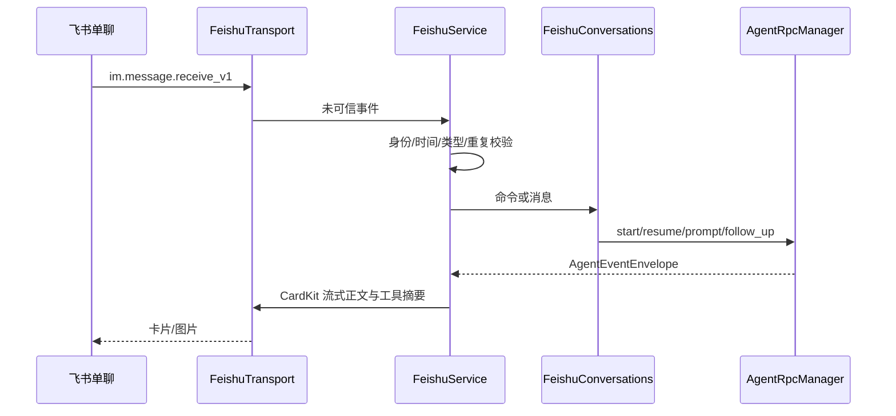

# 07 飞书与语音

[返回目录](README.md) · [上一章](06-tasks-and-schedules.md) · [下一章](08-ipc-and-security.md)

## 1. 飞书接入架构

手机向企业自建应用机器人发送消息，Ptx 用官方 SDK 的出站长连接接收事件，再使用已有 Pi/OMP manager 执行。**飞书功能不需要本机 HTTP listener、Webhook、端口映射或公网隧道。**

机器必须在线且 Ptx 运行。同一应用连接多个桌面实例时，飞书事件可能被分配而非广播，不应把它用作多电脑同步方案。

## 2. 模块责任

| 文件 | 关键类/函数 | 责任 |
| --- | --- | --- |
| [service.ts](../../electron/main/feishu/service.ts) | `FeishuService` | 配置、连接、入站串行队列、命令、回复同步 |
| [binding.ts](../../electron/main/feishu/binding.ts) | `FeishuBinding` | 官方扫码应用注册、状态轮询、取消与凭据交接 |
| [protocol.ts](../../electron/main/feishu/protocol.ts) | `parseConfig`、`admittedMessage`、`parseCommand` | 不可信配置和消息解析 |
| [conversations.ts](../../electron/main/feishu/conversations.ts) | `FeishuConversations` | 同一桌面会话的创建、验证、恢复与读取 |
| [transport.ts](../../electron/main/feishu/transport.ts) | `createFeishuTransport` | SDK Client/WSClient、卡片和媒体传输 |
| [store.ts](../../electron/main/feishu/store.ts) | `FeishuStore` | 加密配置、回执、会话绑定持久化 |
| [cards.ts](../../electron/main/feishu/cards.ts) | `LiveReply`、`cardJson`、`summarizeTools` | 事件聚合与 Card JSON 2.0 |
| [image.ts](../../electron/main/feishu/image.ts) | `detectImageMimeType`、`prepareSessionImage` | 图片签名检查、压缩、RPC 输入适配 |

UI：[FeishuSettings](../../src/pages/settings/FeishuSettings.tsx)、[FeishuBindingDialog](../../src/pages/settings/FeishuBindingDialog.tsx)、[MobileConnectionButton](../../src/components/MobileConnectionButton.tsx)。

## 3. 扫码配置

`beginBinding()` 触发主进程官方注册流程，renderer 只接收二维码图片、过期时间和阶段状态。成功后 `finishBinding({harness,projectId,model})` 将主进程保存的凭据与目标组合，加密持久化。

状态由 [FeishuBindingState](../../src/types/feishu.ts) 表达：`idle/loading/waiting/authorized/error`。用户取消会结束当前流程。

设置页没有手填 secret 的 UI，但 preload 契约仍有 `feishu.save(config,secret)` 方法供已有 API 使用；不能把“无手动输入界面”写成“代码中不存在保存接口”。

飞书平台仍需配置机器人、消息接收权限、发送权限、CardKit 权限、长连接订阅和企业内发布。扫码获得应用信息不等于消息链路已经连通，详见 [原使用指南](../feishu.md)。

## 4. 消息准入与实际支持范围

`admittedMessage()` 核验：

- `sender_type === 'user'`。
- sender Open ID 与本应用配置的 `allowedOpenId` 一致。
- `chat_type === 'p2p'`。
- 消息不超过 5 分钟旧，未来时间偏移不超过 1 分钟。
- message ID、chat ID、正文和图片 key 都有长度限制。

当前实际解析三种形态：

1. `text`：有界纯文本。
2. `image`：图片 key。
3. `post`：包含恰好一张图片的受限富文本结构，可收集附带 text；不是任意富文本/附件支持。

部分既有说明仍写“只支持 text/image，其他均拒绝”，不能覆盖当前 `post` 单图兼容分支。

`FeishuService` 入站串行队列上限 32，持久化近期 message receipt 后再执行，从而避免重复提交。不确定是否成功的历史消息不自动重放；这是一种偏向防重复执行的策略，并不保证失败消息自动恢复。

## 5. 持续会话

`FeishuConversations` 复用桌面目录与 runtime：

| 方法 | 说明 |
| --- | --- |
| `list(config)` | 枚举指定引擎、已授权项目目录内的非归档会话 |
| `require(config,binding)` | 再校验 session UUID、path 和项目归属 |
| `create(config,cwd,chatId)` | 使用配置模型启动，设置标题，登记未落盘 pending session |
| `send(...)` | 空闲时 prompt，忙碌时 follow-up；不阻塞 `/停止` 等待整个模型完成 |
| `stop(...)` | 停止绑定 runtime |
| `transcript(...)` | 一次只读会话读取提取助手回复、用户正文与图片 |

新会话用配置模型；恢复已有会话不覆盖其已有模型。绑定记录保存 `sessionFile/sessionId/chatId/title/delivered/card` 等引用与回执，不另建平行聊天历史。

主要命令：

| 命令 | 行为 |
| --- | --- |
| `/新建`、`/new` | 创建新绑定会话 |
| `/会话`、`/sessions` | 最近 20 个可选会话 |
| `/切换 ID`、`/switch ID` | 按稳定 ID 选择现有会话 |
| `/状态`、`/结果`、`/停止` | 查询、取结果、停止 |
| `/发图 绝对路径`、`/img` | 读取本机图片并发送到该聊天 |
| `/任务 目标` | 普通消息兼容写法 |
| 其他 `/...` | 显示帮助 |

运行中不允许直接切换绑定。断开飞书停止网络投递，但不会隐式取消已经在本机运行的工作。

## 6. 图片与安全细节

入站图片通过认证 SDK 下载，使用单独的有界 HTTP client；检查魔数，必要时将 PNG/JPEG 缩放重编码以满足 RPC 写帧预算；GIF/WebP 仅在足够小时直传。最终仍由 manager 判断模型是否接受图片。

出站镜像区分手机来源与桌面来源，使用 digest/receipt 抑制回显；已同步历史不重复发送。工具截图如果不是会话 `image` part，不自动纳入此镜像路径。超大或被转录截断的图片返回提示。

**显式 `/发图` 的边界需要单独理解：** 当前传输层检查绝对路径、扩展名与 10 MiB 文件大小，向该单聊上传字节；它没有把路径限定在绑定项目根内。该命令在 `receive()` 中也先于后续项目重新授权分支执行。因此不能笼统承诺“所有飞书文件读取都被项目撤销阻断”。启用绑定意味着信任指定账号使用此本机图片发送能力。

SDK 常规 logger 被禁用，但媒体失败分支仍有 `console.warn`，可能包含 SDK 返回错误。排查问题时不要假定日志绝无响应数据，分享前应脱敏。这是实现边界说明，不是一次完整安全审计。

## 7. 流式卡片与恢复

`LiveReply.apply()` 聚合正文和工具状态；服务按秒级 tick 合并更新，避免每个 token 调用飞书 API。

`createCard()` → `sendCard()` → 多次 `updateCard()`：

- 使用 Card JSON 2.0 和 CardKit 实体。
- 正文上限 8,000 个 Unicode 字符，工具摘要最多 50 条。
- 不发送思考、完整工具参数或完整工具结果，仅名称和状态摘要。
- card ID、发送 UUID、sequence、发送/结束标记保存到加密记录。
- 最终关闭 streaming mode 并写入完整卡片后，才记为完成投递。

配置/回执加密依赖 `safeStorage`，无安全后端拒绝保存。创建云端卡片后本地持久化失败可能留下未发送实体，不会因此重发原始开发任务。

## 8. 语音

主进程 [VoiceService](../../electron/main/voice.ts)，UI 为 [VoiceOrb](../../src/components/VoiceOrb.tsx) 与 [VoiceSettings](../../src/pages/settings/VoiceSettings.tsx)，辅助逻辑在 [lib/voice.ts](../../src/lib/voice.ts)。

两类功能：

1. **听写**：OpenAI live、OpenAI、Groq、Deepgram、自托管 OpenAI-compatible endpoint 或本地 whisper。
2. **Realtime 对话**：交换 SDP，建立实时会话，通过受限 voice tools 了解项目/模型并启动工作。

主要方法：

| 方法 | 责任 |
| --- | --- |
| `credentialStatus()` | 只返回凭据存在性与安全存储状态 |
| `saveApiKey()` / `deleteApiKey()` | 管理 Ptx 专属 voice 凭据 |
| `createRealtimeCall()` | 校验请求并处理 Realtime SDP |
| `transcribe()` | 校验音频并分派 provider 或本地 whisper |
| `testSelfHosted()` | 检查自托管配置 |
| `executeTool()` | 白名单语音工具，基于指定 harness 的目录和 manager |

Realtime 会话固定在打开时的 harness，切换引擎会关闭 orb；模型选择只在 GUI 活动模型范围内进行。`start_task` 经项目/模型授权后立即 prompt，没有第二次桌面确认；它启动的是 agent 工作，不等于创建任务页中的 `DevelopmentTask`。

### 8.1 凭据与网络

- voice keys 与 Pi/OMP 模型账户独立。
- macOS Keychain、Windows DPAPI、Linux 可用 secret store 才支持持久保存；Linux `basic_text` 不接受。
- 无安全存储时新 key 可按明确路径仅保存在本次主进程内存，不回传 renderer。
- 自托管端点公网要求 HTTPS，本机/私网允许受限 HTTP；拒绝 URL 中凭证、query/fragment 和重定向。
- 仅可信主框架可请求音频权限，远程 guest、视频及子框架不获得此权限。
- 语音上下文可包括时区/locale 推导信息，不申请精确地理位置。

## 9. 桌面宠物

[PetService](../../electron/main/pets.ts) 只读枚举内置资源及 `~/.codex/pets` 中的合规包，检查非 symlink、manifest、ID 和 spritesheet 大小。

[DesktopPet](../../src/components/DesktopPet.tsx) 与 [PetAvatar](../../src/components/PetAvatar.tsx) 呈现动画、活动与语音入口。内置 Orb/Ptx 不依赖用户安装 Codex，外部宠物发现也不代表允许执行包中代码。

## 10. 验证边界

自动测试可证明身份过滤、配置约束、协议封装、去重、会话路由和 UI 行为；不能代替真实飞书企业发布权限、客户端卡片渲染、模型账号、音频设备或外部服务连通性验证。本次 Wiki 生成没有执行这些真实联调。
