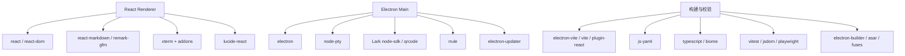

# 09 依赖与运行指南

[返回目录](README.md) · [上一章](08-ipc-and-security.md) · [下一章](10-testing-and-release.md)

## 1. 工程基本信息

来自当前 [package.json](../../package.json)：

| 项目 | 值 |
| --- | --- |
| 包名/版本 | `ptx` / `1.0.0` |
| 应用主入口 | `out/main/index.js` |
| 包模块类型 | `module` |
| Electron appId | `app.ptx.desktop` |
| 产品名 | `Ptx` |
| 许可证 | MIT |
| 打包工具 | electron-builder |
| 构建工具 | electron-vite + Vite |

版本号仅是本文分析基线，不是“当前上游最新版本”声明。

## 2. 依赖关系



### 2.1 生产依赖

以下为分析时锁文件实际解析版本，不是只复制 semver range：

| 包 | 锁定版本 | 用途 |
| --- | --- | --- |
| `@larksuiteoapi/node-sdk` | 1.76.0 | 飞书应用注册、长连接、IM、CardKit |
| `electron-updater` | 6.8.9 | 打包应用更新状态、下载与安装 |
| `js-yaml` | 5.5.0 | 发布脚本读取/生成 YAML 更新清单；虽声明为生产依赖，当前直接使用点在 release 脚本 |
| `node-pty` | 1.1.0 | 原生 PTY |
| `qrcode` | 1.5.4 | 飞书扫码二维码图像 |
| `rrule` | 2.8.1 | 重复调度时间规则 |

### 2.2 主要构建/前端依赖

| 包 | 锁定版本 | 用途 |
| --- | --- | --- |
| `electron` | 43.4.0 | 桌面运行时 |
| `react` / `react-dom` | 19.2.8 | renderer UI |
| `typescript` | 7.0.2 | 编译类型检查 |
| `vite` | 7.3.6 | renderer 编译/开发服务 |
| `electron-vite` | 5.0.0 | main/preload/renderer 三入口构建 |
| `electron-builder` | 26.15.7 | 平台打包 |
| `@biomejs/biome` | 2.5.8 | lint/format |
| `vitest` / `@vitest/coverage-v8` | 4.1.10 | 单测与覆盖率 |
| `@playwright/test` | 1.62.1 | Electron E2E |
| `jsdom` | 30.0.1 | 前端 DOM 测试环境 |
| `react-markdown` / `remark-gfm` | 10.1.0 / 4.0.1 | Markdown/GFM |
| `@xterm/xterm` | 6.0.0 | 终端渲染 |
| `@xterm/addon-fit` / `addon-web-links` | 0.11.0 / 0.12.0 | 终端尺寸和链接 |
| `lucide-react` | 1.31.0 | 图标 |
| `@electron/asar` / `@electron/fuses` | 4.2.1 / 2.1.3 | 包归档与运行时安全开关 |

React 等位于 `devDependencies`，但它们被编译进 renderer 成品，不意味着安装后的桌面 UI 不依赖这些代码。main/preload 使用 externalizeDepsPlugin，生产运行依赖由打包流程保留。

`extract-zip` 通过 override 指向 `@electron-internal/extract-zip@1.0.5`。当前没有 `prime-agent`、`prime-agent-ai`、`zeromq`，也没有使用 React Router、Redux、Tailwind。

完整直接/间接依赖以 [package-lock.json](../../package-lock.json) 为准。

## 3. 外部运行条件

- 安装并可执行的 Pi 或 OMP CLI，至少一种即可。
- 用各 CLI 自己的方式登录/配置模型账户。
- 项目 Git 功能需要 Git。
- 本地终端需要平台 shell；node-pty 是原生模块，需要匹配 Electron ABI。
- 本地 whisper、TryCUA、飞书、云端语音是可选能力，不是启动应用的强制依赖。
- 桌面 secret store 决定飞书/语音凭据能否安全持久化。

Ptx 不替用户自动安装 Pi/OMP 或 TryCUA，不需要先启动单独业务服务器。

## 4. 从源码启动

工具链唯一权威为 [`.nvmrc`](../../.nvmrc)、`package.json#engines`、`packageManager` 和 [preflight](../../scripts/release/preflight.mjs)。

分析基线记录：`.nvmrc` 为 Node `24.15.0`，`packageManager` 为 npm `12.0.2`，engines 分别设定对应下限。执行时重新读取元数据，不依赖 Wiki 中冻结的版本。

在仓库根目录：

```bash
nvm install
nvm use
npm run toolchain:bootstrap
npm ci
npm run release:preflight:toolchain
npm run dev
```

`toolchain:bootstrap` 校验 vendored npm 包的大小和 SHA-512，再离线安装指定 npm 到当前 npm prefix；这是会改变该工具链安装的操作，执行前应确认使用目标 nvm 环境。

`npm ci` 适用于复现锁文件，不会重新解析版本范围；`postinstall` 同步安装 Electron 平台运行时并触发原生依赖重建。

### 4.1 找不到 nvm 或 Node 被覆盖

已安装 nvm 的 shell 可使用：

```bash
export NVM_DIR="$HOME/.nvm"
. "$NVM_DIR/nvm.sh"
nvm use
node -v
npm -v
```

Windows 原生环境可使用适合 Windows 的版本管理器/Node 安装器选择匹配版本，再执行 bootstrap 与 preflight；不能直接照搬 POSIX shell 的 nvm 加载命令。

### 4.2 Linux 无显示环境

配置好 Electron 所需系统库和虚拟显示后：

```bash
xvfb-run -a npm run dev
```

不要使用禁用沙箱的参数代替正确系统配置。工作区工程说明提到的 `.cursor` 云环境脚本在本次文件树中不存在，不能假定克隆当前仓库便自动安装这些依赖。

## 5. 构建与预览

```bash
npm run build
npm run preview
```

- `build` = 五个 TypeScript 项目检查 + `build:bundle`。
- `build:bundle` = `electron-vite build`，不会单独运行 typecheck/测试。
- `preview` 预览已有构建，不是安装包验证。
- bundle-size 门禁在 `release:bundle-size` / 发布验证聚合中，不是 `build` 脚本内自动执行的步骤。

[electron.vite.config.ts](../../electron.vite.config.ts)：

| 构建目标 | 输入/输出与特征 |
| --- | --- |
| main | `electron/main/index.ts` → `out/main/index.js`，外部化生产依赖并压缩 |
| preload | `electron/preload/index.ts` → `out/preload/index.js`，CJS 格式 |
| renderer | `index.html` → `out/renderer`，React、`@` alias、手动 vendor chunks |

主包、preload 和 renderer 都显式压缩；renderer 分为 React、Markdown、终端、icons 等 vendor chunk。

## 6. 本机 QA 安装包

只在匹配平台运行对应命令：

```bash
npm run package:mac:local-qa
```

```bash
npm run package:linux:local-qa
```

```bash
npm run package:win:local-qa
```

平台格式：

| 平台 | 配置目标 |
| --- | --- |
| macOS | DMG、ZIP |
| Linux | AppImage、DEB、RPM、pacman |
| Windows | NSIS、ZIP、AppX |

输出位于 `release/` 及脚本指定的平台子目录。QA 不等于签名/公证正式发行；不要将未签名 AppX 当作普通可直接安装的正式包。

## 7. 更新机制

[UpdateService](../../electron/main/updates.ts) 管理 `idle/checking/available/downloading/downloaded/not-available/error/unsupported`。

- 仅打包构建启用自动更新。
- 启动后检查，并以默认三小时间隔检查。
- 发现更新不意味着立即自动下载安装；用户操作触发后续流程。
- 测试包 manifest 可带 `ptxUpdateChannel=testing`。
- macOS 未签名 QA 包可带 `ptxUpdateInstall=manual`，打开 release 下载页手动更新。
- 不自动降级；相同版本号替换文件不能作为升级验证。

## 8. 常见问题

| 症状 | 优先检查 |
| --- | --- |
| Pi/OMP 不显示 | CLI 是否可执行、设置绝对路径、对应环境变量、刷新发现及版本探测错误 |
| 模型可选却调用失败 | harness 自己的认证/模型配置；目录可选不保证认证 |
| 项目可看但无法执行 | 是否推断/只读项目，显式授权和目录身份是否有效 |
| 找不到 Electron binary | 是否跳过 install scripts 或平台下载失败 |
| PTY 加载失败 | 是否按当前 Electron ABI 重建 node-pty，编译器/Python 是否可用 |
| MCP 无法添加 | Pi adapter 是否规范启用，是否误填 HTTP/SSE |
| 任务结束未已验收 | 正常行为，需检查证据后人工确认 |
| 关闭窗口后 schedule 不执行 | 后台选项、进程是否退出、系统是否休眠 |
| 飞书绑定成功但无消息 | 权限、事件订阅、应用发布、Open ID、桌面长连接 |
| Linux 凭据不能保存 | 可用 secret store；不接受不安全 basic_text 回退 |
| 运行时状态串到别的聊天 | 检查 generation、runtime owner 和迟到异步结果 |

如果曾使用 `npm install --ignore-scripts`，在正确工具链下执行恢复：

```bash
node node_modules/electron/install.js
npx electron-builder install-app-deps
npm run dev
```

这不是默认推荐安装路径；若还需指定 Python，应设置为实际可用路径，不能直接复制文档占位值。
