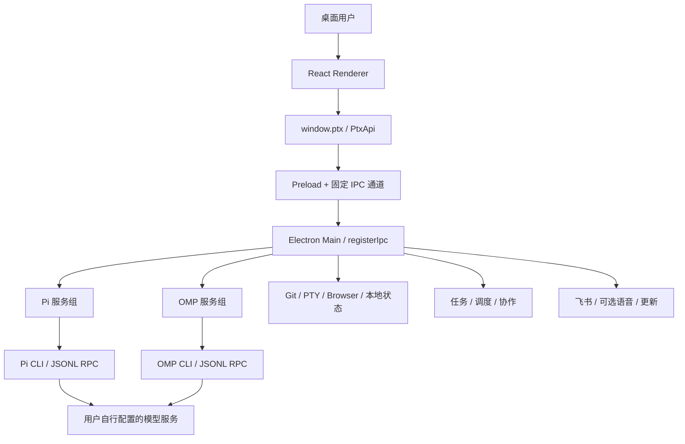

# Ptx Code Wiki

> 中文源码知识库。分析日期：2026-10-19。项目版本：`1.0.0`。
> 源码基线：`ff4c25f502b9ce043d02b842fece7975b56b9c0f`，开始分析时工作区干净。

## 1. 项目是什么

Ptx 是以 Electron + React + TypeScript 实现的本地 AI 开发桌面工作区，支持 macOS、Linux 和 Windows。它把 **Pi、OMP 两种外部编码代理 CLI** 的项目、会话、模型选择和执行状态组织到一个 GUI 中，并提供 Git、终端、浏览器、任务验收、定时执行、会话协作、飞书移动接入和语音功能。

Ptx 本身不是大模型服务，也不是 Pi/OMP 的重实现。模型调用、模型账户登录以及会话 JSONL 的写入由 CLI 负责；Ptx 管理桌面交互、启动权限和本地应用状态。

## 2. 文档目录

| 文档 | 内容 | 适合读者 |
| --- | --- | --- |
| [01 总体架构](01-architecture.md) | 进程边界、目录、启动与退出、服务依赖图 | 所有开发者 |
| [02 代理运行时与协议](02-agent-runtime.md) | CLI 发现、适配器、RPC、模型目录、消息调用链 | 代理集成开发者 |
| [03 数据与项目授权](03-data-and-projects.md) | 数据模型、状态文件、项目授权、会话目录与转录 | 后端与数据维护者 |
| [04 前端与状态管理](04-renderer.md) | 页面组件、hooks、工作区隔离、流式渲染、样式 | 前端开发者 |
| [05 本地工具与能力扩展](05-capabilities.md) | Git、PTY、浏览器、MCP、扩展、会话协作 | 能力集成开发者 |
| [06 任务与定时执行](06-tasks-and-schedules.md) | 两套状态机、人工验收、重试、错过执行恢复 | 工作流开发者 |
| [07 飞书与语音](07-feishu-and-voice.md) | 扫码、消息过滤、持续会话、流式卡片、语音、桌面宠物 | 外部集成开发者 |
| [08 IPC 与安全边界](08-ipc-and-security.md) | API 域、IPC 路由、信任验证、权限与风险边界 | 涉及主进程的开发者 |
| [09 依赖与运行指南](09-dependencies-and-running.md) | 技术栈、依赖版本、安装、开发、构建、故障排查 | 新成员与使用者 |
| [10 测试与发布](10-testing-and-release.md) | 类型检查、单测、E2E、覆盖率、包体积、发布流水线 | 测试与发布维护者 |
| [11 源码导航与维护](11-source-navigation.md) | 关键类函数索引、需求到文件映射、历史差异与更新规则 | 长期维护者 |

阅读路线：

- 快速运行：本文 → 09 → 10。
- 理解一次对话：01 → 02 → 04 → 03。
- 修改主进程能力：08 → 对应专题 → 11。
- 理解产品工作流：06 → 07 → 05。

## 3. 架构速览

## 4. 五个关键认识

1. **目前只有 Pi 和 OMP。** [HARNESS_IDS](../../src/types/api.ts) 与 [HarnessRuntimeMap](../../electron/main/harness-runtime.ts) 是当前依据。Prime 的运行时及 `zeromq` 已移除。
2. **展示状态不等于持久化事实。** React 展示实时事件；磁盘转录来自 harness；桌面配置、任务与调度是 Ptx 自己的数据。
3. **目录出现不等于执行授权。** 会话推断项目可获得只读访问；启动代理、终端、修改 Git 或配置需要显式项目授权。
4. **结束不等于验收。** 开发任务完成一次执行进入 `review`，必须由用户确认才能进入 `accepted`。
5. **本地优先不等于完全离线。** harness 调用模型，飞书/语音/更新也可能联网；用户需要了解各入口的外发数据。

## 5. 分析范围与可信度

本套 Wiki 依据当前源码、类型定义、`package.json`、锁文件、测试与工作流进行静态分析。覆盖全部主要生产子系统，对关键实现给出类、方法、调用链和可点击源码路径；不逐个解释所有 UI 私有回调、测试辅助函数或第三方内部实现。

分析时目录规模如下，按 `.ts/.tsx/.mjs/.cjs` 文件统计，包含目录内声明文件及测试 fixture，不代表测试用例数量：

| 目录 | 文件数 |
| --- | ---: |
| `electron/main/` | 80 |
| `electron/preload/` | 1 |
| `src/` | 137 |
| `tests/` | 183 |
| `scripts/release/` | 19 |

事实优先级为：**当前可执行实现及脚本 → 类型与测试契约 → 当前说明文档 → 历史设计文档**。遇到文档和源码不一致，本套 Wiki 说明差异，不将旧设计描述为当前功能。

本次只新增文档，不修改业务代码，不读取用户的会话正文、模型凭证或应用私有数据，不安装依赖，不执行真实模型任务、飞书绑定或发布操作。文档中的测试命令是可复现指南，**不是本次测试通过证明**。

## 6. 术语

| 术语 | 本仓库中的含义 |
| --- | --- |
| Harness | 外部代理执行环境，目前为 `pi` 或 `omp` |
| Runtime | Ptx 管理的一个活动 CLI 子进程，以 `runtimeId` 标识 |
| Session | harness 持久化会话，以会话 UUID 与 JSONL 文件路径标识，可跨 runtime 恢复 |
| Project Grant | 用户显式授权的项目目录及目录身份，不只是界面分组 |
| Workspace | 前端当前项目、目录、会话、runtime 与 UI 状态组合 |
| Transcript | 从 JSONL 或实时事件归一化得到的 `TranscriptMessage[]` |
| Capability | 插件、扩展、技能、MCP 及内置工具的统一产品入口 |
| Broker / Bridge | 代理扩展调用主进程能力的回环 HTTP 服务，使用 runtime 级 token |
| Task | 带目标和验收要求的开发任务，对应 `TaskService` |
| Schedule | 一次性或重复的自动运行定义，对应 `AutomationService` |

## 7. 原始资料

- [仓库 README](../../README.md)、[工程规则](../../AGENTS.md)。
- [安全模型](../security.md)、[验证指南](../validation.md)。
- [Prime 移除说明](../prime-removal.md)、[Pi 集成](../pi-integration.md)、[OMP 集成](../omp-integration.md)。
- [任务工作流](../task-workflow.md)、[飞书接入](../feishu.md)、[能力集成](../capability-integrations.md)。

本 Wiki 使用相对链接，便于在仓库 Markdown 查看器与代码托管平台中阅读。Mermaid 图是辅助表达，不支持 Mermaid 的查看器仍可通过相邻文字和表格理解。

## 8. 文档校验

交付前执行静态校验：相对链接目标、源码行号、npm script 名称、代码围栏配对和行尾空白。核心符号与相关源码再次核对，依赖用途及版本分别由实际导入和锁文件确认。

未执行 Markdown 图形渲染测试、完整应用测试或真实服务联调；本文所引用的现有测试文件表示验证入口，不表示它们在本次分析中已运行通过。
