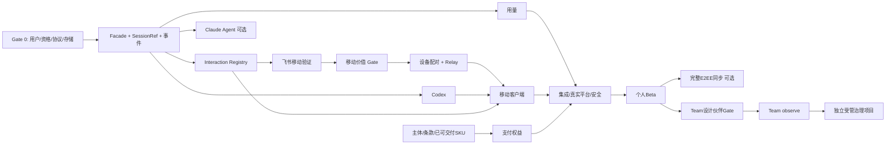

# PTX plan2 实施任务与验收计划

[可行性评估](plan2-feasibility.md) · [技术实现方案](plan2-implementation.md)

状态：待立项方案，不代表已实施、已测试或取得服务商许可。所有工时均为工程估算，需 Gate 0 的协议和存储 PoC 后重估。

## 1. 建议先做什么

**无条件启动的只有 Gate 0：需求、资格、技术风险验证。** 后续不是按时间自动解锁，而是达到证据门槛后才投入。

默认沿用 [现有商业验证手册](business/validation-playbook.md)，保留当前免费能力与任务预览。原 `plan2.md` 不改，评估与本方案作为决策补充。

不在这一轮实现代码、安装依赖、接入账号、启动付费推理、申请证书、创建云资源或发布收费版本。

## 2. 两种资源方案

### 2.1 单人每周 20 小时：验证现有生意

沿用开发 12 小时、访谈/支持 5 小时、演示复盘 3 小时。12 周约 144 开发小时，仅 3.6 人周。

| 周期 | 开发切片 | 证据与业务工作 | 退出条件 |
| --- | --- | --- | --- |
| 第 1–2 周 | 从既有错误反馈选一个首次任务阻塞点；计量/新引擎只做限时技术验证 | 10 人访谈，5 人真实任务观察；确认认证资格 | 重复痛点不足，不扩大开发 |
| 第 3–4 周 | 修首次任务、任务状态与证据来源展示，补回归 | 10 人试用，至少 7 人独立成功、5 人次周复用 | 首次失败优先修，不做云 |
| 第 5–8 周 | “任务证据增强”或“Pi/OMP 有界用量摘要”选一项；支付仅在已准备好商户时排入并替换其他工作 | 演示已可交付价值，条款就绪后争取 3 笔真实付款 | 无支付条件只收意向，不冒充付款 |
| 第 9–12 周 | 解决付费/活跃用户最高频问题；脱敏支持诊断 | 20 名有效试用、5 名付款、3 名连续四周使用 | 根据数据继续、收窄或停止 |

本方案不承诺此投入量同时交付 Codex、Claude、E2EE、移动审批、SSO 或完整支付系统。低开发预算下优先留住用户，再决定提高投入。

### 2.2 小团队专职：个人扩张 Beta

假设 2 名桌面/协议工程师、1 名后端工程师；另有兼职产品/设计、QA、安全和法务。1 人周 = 40 小时，以下不含证书/伙伴审批/采购等待。

| 工作包 | 人周 | 主要前置 |
| --- | ---: | --- |
| Gate 0 技术与资格核对 | 1–2 | 当前源码/访谈 |
| Runtime/session facade + 事件双通道 | 3–4 | Gate 0 |
| Pi/OMP 用量账本与 UI | 2–3 | facade/存储验证 |
| 主进程 interaction registry | 2–3 | 事件双通道 |
| Codex driver（通过资格的模式） | 4–6 | 契约、schema、认证结论 |
| 控制面身份/配对/relay | 4–6 | 移动价值 Gate、威胁模型 |
| 移动客户端与有限审批 | 3–5 | interaction、配对、可审批 driver |
| 订单/权益/退款 | 2–3 | 商户、条款、售卖范围 |
| 跨平台、集成、安全与发布加固 | 3–7 | 上述功能完整切片 |
| **合计** | **24–39** | 不含下列扩展包 |

考虑依赖、并行和联调，日历约 12–18 周只是排期假设；资格未批准、driver 风险、真实平台问题会延后。不能把 39 人周理解成一个人 39 天。

额外范围单独估算：

- Claude Agent SDK driver：4–7 人周，认证/品牌/SDK worker 兼容通过后。
- E2EE 模板与完整转录/附件同步：4–7 人周，含恢复和冲突，不只是上传文件。
- Team observe/advisory + 身份/报表：10–16 人周，须设计伙伴与明确范围。
- Managed 强制治理、云执行、插件交易：独立立项，现阶段不提供固定交付日期。

月人员成本公式：`各角色全成本月薪之和 × 实际月数`；基础设施、第三方认证、法务、签名和支持另计。没有工资/地区信息，不提供伪精确总预算。

## 3. 任务依赖



Codex 未获资格时，不让整个现有产品停摆；保留 Pi/OMP，但只能对已验证的交互类型提供远程处理。不能把不可审批引擎假装成可审批以凑齐 Beta 功能。

## 4. Gate 0：先消除阻断项

负责人：产品负责人 + 桌面/协议工程师；资格判断由授权负责人/法务确认。

| ID | 工作 | 交付物 | 验收 |
| --- | --- | --- | --- |
| G0-01 | 对齐 plan1/plan2 目标与投入 | 一页 ADR：目标用户、SKU、非目标和预算 | 明确不自动替换现有免费边界 |
| G0-02 | 核对 Claude/Codex 准确分发与认证模式 | 模式矩阵、条款链接、书面批准/限制记录 | 本地开源与商业/托管不混用；未批准入口关闭 |
| G0-03 | 固定候选 CLI/SDK 版本并收集协议 | schema hash、脱敏 trace、能力矩阵 | 覆盖启动、流式、恢复、停止、错误、审批、usage |
| G0-04 | 验证本地数据库实现 | 目标 Electron 三平台 PoC | 不关闭 fuses；崩溃事务、WAL、备份可恢复 |
| G0-05 | 盘点实际收费准备 | 商户/主体/条款/退款/SKU 清单 | 不存在虚假购买入口 |
| G0-06 | 观察真实用户任务 | 经同意的匿名验证记录 | 不复制用户源码、密钥或原始转录 |

G0-03 涉及实际账号和费用，执行前必须由用户明确提供许可及自用测试环境；只读文档不能替代实测。协议 trace 必须脱敏，不把 auth、cookie、prompt 或客户代码提交到仓库。

## 5. Phase 1：兼容基础层

负责人：桌面工程师。新增目录是拟议位置。

| ID | 工作项 | 修改面 | 完成标准 |
| --- | --- | --- | --- |
| F-01 | 定义 `HarnessDriver/SessionRef/CapabilitySnapshot` | 新 `src/types/harness.ts`、`electron/main/harness-drivers/` | 无 Node renderer import，能力含 unsupported |
| F-02 | 包装 Pi/OMP manager | `harness-runtime.ts`、现有 manager facade | 旧 wire 不变，现有场景回归 |
| F-03 | 不透明 sessionKey 注册 | 新 session reference service、IPC | 不伪造路径，native ID 不能跨 harness/project |
| F-04 | 逐个迁移消费者 | tasks、schedule、voice、Feishu、collaboration、terminal/browser | 每次迁移独立测试、可回退 |
| F-05 | 领域/展示双通道 | `runtime.ts`、`events.ts`、主进程 composition | usage/interaction 不依赖 UI 限流；资源仍有界 |
| F-06 | activity 存储及迁移 | 新 store adapter/worker | 单写者、断电/磁盘满/未知版本 fail safe |
| F-07 | 固定 IPC 类型与取消订阅 | preload、ipc、src/types | 无 raw invoke；所有方法经过可信主框架校验 |

允许 Pi/OMP 先继续 file-based facade；只有消费者完成迁移后才启用 native-only session。不要为缩短工期将所有 filePath 检查改成 optional 后让各服务自行猜测。

**发布门槛：** 所有既有 Pi/OMP 测试及真实原生 smoke 的新增回归均解决；不新增用户可见付费墙。采用按职责提取，避免继续膨胀已超 750 行的核心文件。

## 6. Phase 2：用量与任务证据

| ID | 工作项 | 修改面 | 完成标准 |
| --- | --- | --- | --- |
| U-01 | 定义计量来源/口径 profile | 新 `usage/profiles.ts` 及 driver profile | delta/cumulative、step/turn/session、cache/reasoning 明确 |
| U-02 | 收集与去重 | `usage/collector.ts`、原生事件入口 | 重复、恢复和 backfill 不重复累计 |
| U-03 | 有界只读回填 | Pi/OMP JSONL parser adapter | 不改文件；offset 失效时重验；可取消 |
| U-04 | 价格账本 | `usage/pricing.ts` 与版本化数据 | 来源/币种/生效期；未知不当 0 |
| U-05 | 聚合与导出 | service、IPC、UsagePage | 时间/项目/引擎维度；CSV 注入防护 |
| U-06 | 软预算通知 | usage service、任务详情 | 只提醒，不声称硬止损 |
| U-07 | 任务证据来源增强 | TaskService/TaskEvidence/TaskDetail | 检查记录有实际来源，AI 文本不冒充进程结果 |

数据集至少包含：多个模型、缓存、reasoning 子集、重复 assistant ID、call 与 session total、重试、同一天恢复、时间跨日、未知价格、免费/订阅 provider、被截断转录和缺口。

**发布门槛：** 固定 fixtures 的已知计量误差为 0；未知模式明确显示 incomplete；100k rows 查询目标在指定参考机器上通过。不能以“误差看起来很小”掩盖口径未定义。

## 7. Phase 3：问题与审批

| ID | 工作项 | 修改面 | 完成标准 |
| --- | --- | --- | --- |
| I-01 | 持久化 request 状态机 | 新 `interactions/service.ts` | pending/claimed/dispatched/resolved/invalid 分明 |
| I-02 | 从 renderer 迁出 ownership | `useExtensionUi.ts`、IPC | 关闭/切换窗口不丢请求；旧 response 入口不绕过 |
| I-03 | driver 请求与回答映射 | Pi/OMP adapter、后续新 driver | 问卷不是权限，分清 native ACK 与写入成功 |
| I-04 | 原子决定与失效 | InteractionService、PolicyService stub | 双端抢答仅一次；runtime/grant/revision 改变拒绝 |
| I-05 | 飞书低成本验证 | Feishu protocol/service/UI | 新命令/回调显式准入；无法核对内容不允许 |
| I-06 | 未验证能力降级 | capability/UI | 通知/拒绝/回桌面，不伪造批准 |
| I-07 | 既有图片入口收紧 | Feishu service/transport | `/发图` 先验证绑定/grant；限制 canonical 图片范围、拒绝 symlink/替换越界，受管模式默认关闭 |

首版远程禁止：永久允许、修改 shell 参数、增加 grantRoot、扩展网络权限。管理员和付款状态均不能自动绕过本机授权。

**发布门槛：** 并发响应、过期、应用重启、旧 runtime、伪造 request、grant 撤销、ask-user 不完整问卷和 pipe 写入不确定都能安全终结。

## 8. Phase 4：新引擎

### 8.1 Codex

| ID | 工作项 | 完成标准 |
| --- | --- | --- |
| C-01 | 发现与版本/schema 校验 | 固定可执行文件和 argv；未知版本告警/限制 |
| C-02 | 双向 JSON-RPC transport | initialize 成功再 initialized；request/notification/server request 区分 |
| C-03 | 线程与 turn 生命周期 | 创建、恢复、正文、错误、interrupt、crash 对齐 |
| C-04 | 原生 session adapter | 原生 ID，不假路径；list/read 按本机项目授权 |
| C-05 | 用量和模型 | 原生 usage 口径明确；model/list 不等于认证成功 |
| C-06 | 审批 | command/file/network 内容分开；serverRequest/resolved 使旧请求失效 |
| C-07 | 合规认证路径 | 不读取原有 auth 文件；不把本地开源 auth 直接用于收费服务 |
| C-08 | UI/任务/schedule 能力接入 | unsupported 操作被解释性禁用，不 silent fallback |
| C-09 | 进程级工具 shim（可选） | 固定 stdio MCP，仅允许工具子集；不改全局配置 |

**必须拒绝：** raw `thread/shellCommand`、原始历史注入、通用 config 写入、MCP OAuth、跨 grant thread 和远程任意 RPC。

### 8.2 Claude Agent（独立扩展包）

| ID | 工作项 | 完成标准 |
| --- | --- | --- |
| A-01 | SDK worker/依赖与许可证 | 原生打包可启动，不放宽 Electron fuses；品牌合规 |
| A-02 | streaming/query/resume/interrupt | 原生消息归一化且不重放不确定 prompt |
| A-03 | canUseTool 与 hooks | 问题/权限区分，未知工具 fail closed |
| A-04 | settings/tools 准入 | 不静默加载项目 hooks/MCP；最小默认配置 |
| A-05 | 用量口径固定 | 两次 query/resume 的实际 trace 明确 call/session scope |
| A-06 | API 模式 onboarding | 费用说明；用户配置进入隔离进程；无订阅滥用 |

新引擎 ship Gate 与其他工作独立；协议可行但资格不清晰时保留内部 PoC，不开商业入口。

## 9. Phase 5：可选云与移动

在“至少 5 人真实离桌处理、3 人连续两周复用”的内部门槛成立后开始。

| ID | 工作项 | 完成标准 |
| --- | --- | --- |
| R-01 | 身份与账户隔离 | 成熟 OIDC/passkey；服务端决定 account/tenant |
| R-02 | 桌面/手机密钥与配对 | 一次性 QR、短认证串、本机确认，无长期 QR secret |
| R-03 | 出站 relay | WSS 鉴权、大小/速率预算；不暴露本地 listener |
| R-04 | 命令签名/重放防护 | device/session/grant/epoch/digest 绑定 |
| R-05 | 持久 receipt 与查询 | at-least-once 去重；indeterminate 不自动重做 |
| R-06 | 移动任务/待办 UI | 状态、问题、有限审批、停止；无任意 shell |
| R-07 | 撤销/离线/重连 | 撤销阻止后续操作；TTL 过期不执行 |
| R-08 | 密码学/客户端威胁评审 | test vectors、恶意 relay；PWA 代码发行信任限制公开 |
| R-09 | 隐私与数据范围开关 | 明确云元数据、飞书明文和 E2EE 内容区别 |

个人 Beta 只做必要的密文命令/摘要。完整转录镜像、附件历史、跨设备模板冲突和恢复 key 流程是下一包，不在 relay 成功后自动宣告“全量 E2EE 同步完成”。

### 9.1 控制面数据模型最低约束

| 实体 | 关键约束 |
| --- | --- |
| Account / Identity | provider subject 唯一，不以可变邮箱当主键 |
| Device | account 外键、公钥、epoch、revokedAt |
| Pairing | 两端 device、一次性 nonce、expiry、本机签名 |
| RelayEnvelope | commandId、from/to device、expiry、ciphertext；短保留 |
| SyncObject | account + object + revision 唯一，密文和 tombstone |
| Tenant / Membership | tenant + account 唯一，角色、状态和撤销版本 |
| Policy | tenant + revision 唯一，签名、生效/过期 |
| Order / PaymentEvent | merchant + providerEventId 唯一，币种/金额不可浮点 |
| Entitlement | product/scope/effective period，关联真实 order |
| AuditCheckpoint | device + epoch + sequence 唯一，远端 receipt |

必须为所有多租户查询做跨 tenant 负例，不能依赖 UI 隐藏。密文对象 ID 或 presigned URL 不能成为无期限公开下载链接。

## 10. Phase 6：支付与发行

| ID | 工作项 | 完成标准 |
| --- | --- | --- |
| B-01 | SKU、条款与许可边界 | 保留既有免费功能；售卖范围真实；不含模型额度 |
| B-02 | checkout/订单 | 服务端创建，限定返回域名，不信 renderer paid |
| B-03 | webhook | 原始 body 验签，重复/乱序/重试幂等 |
| B-04 | 权益与离线包 | 主进程验签，key rotation、到期、grace |
| B-05 | 退款/拒付/恢复 | 不删除用户数据；不能旧回调复活已退款权益 |
| B-06 | 原生签名发行 | 证书身份/公证/Windows 原生 smoke |
| B-07 | 支持与诊断 | 脱敏预览、范围/SLA、工单与反馈删除流程 |

支付必须先沙盒覆盖成功、取消、失败、重复订单、网络中断、延迟回调、退款、拒付、续期、到期和设备迁移，再少量真实订单验收。沙盒不计入商业验证的付款人数。

不得把“买断”或“订阅”选项预先写进 UI，直到主体、价格、续期和支持期限确定。

## 11. Phase 7：同步与 Team

### 11.1 E2EE 扩展包

| ID | 工作 | 验收 |
| --- | --- | --- |
| S-01 | 数据分类与对象加密 | grants/auth/token 不进同步清单 |
| S-02 | 新设备与恢复 key | 云账户找回不能自动解密旧数据 |
| S-03 | 模板/偏好 revision | 并发冲突副本，安全数据不 LWW |
| S-04 | 可选转录/附件镜像 | 默认关闭、不覆盖 JSONL、不自动生成本机执行权 |
| S-05 | 撤销/epoch/tombstone | 已下载内容无法撤回的限制公示；旧设备不复活数据 |
| S-06 | 删除/导出/恢复演练 | 按实际保留政策清理对象和备份 |

### 11.2 Team observe/advisory

先有 2 个有预算负责人的设计伙伴、明确采购目标和试点数据范围。

| ID | 工作 | 验收 |
| --- | --- | --- |
| T-01 | Tenant、RBAC、SSO/SCIM | 跨租户隔离，离职撤销，身份平台实际联调 |
| T-02 | 签名策略 | 本机 grant 取交集，不能远程扩大权限 |
| T-03 | 入口全覆盖 | agent、schedule、voice、Feishu、collab、Git、PTY、plugin 逐项验证 |
| T-04 | 操作记录与覆盖声明 | UI 限流不丢重要记录；未观测/gap 可见 |
| T-05 | 远端 checkpoint/WORM | 改链/删尾/换设备 key 可检测；不声称源事件不可伪造 |
| T-06 | 汇总报表与保留政策 | E2EE 与可索引字段明确分离并取得同意 |
| T-07 | 销售/支持/安全资料 | 实际 SLA、成本、企业部署和退出导出流程 |

**不在本包承诺：** 阻止管理员修改本机程序、拦截所有 CLI 内部动作、完整 DLP、等同法定合规认证。需要 managed/enforced 的客户单独确定 MDM、gateway/runner、离线 lease 和平台执行控制。

## 12. 测试与安全验收矩阵

| 领域 | 必测场景 | 判定 |
| --- | --- | --- |
| 旧功能 | Pi/OMP 启动、恢复、模型、任务、schedule、图片、终端、飞书 | 新 facade 不造成已知回归 |
| 状态迁移 | v4→新 schema、崩溃、旧版重开、未知版本、Windows marker | 不复活已撤销授权，不误分配引擎 |
| 协议 | 错 id、乱序、双向请求、坏 JSON、超帧、未知字段、stdout flood | 无越权、队列有界、有错误 |
| 计量 | duplicate、resume、reset、backfill、多模型、订阅、缺价格 | 已知值准确，未知不伪造 |
| 审批 | 两端同时回答、过期、正文变更、已完成 turn、撤销、重启 | 最多一次决定；不确定不重发 |
| 远程 | 伪签名、重放、跨项目/账户、旧 epoch、时钟偏移、恶意 relay | 本机主进程拒绝；云登录无执行权 |
| 同步 | 密文替换、回滚、新设备、公钥替换、丢 key、删除复活 | 验证/冲突/不可恢复明确显示 |
| 团队 | IDOR、角色变更、SCIM 离职、过期策略、旁路入口 | 有效限制交集；不支持强制则阻止 managed |
| 支付 | 重复/乱序 webhook、假成功页面、退款后旧消息、离线时钟回拨 | 权益真实一致，不删数据 |
| 数据 | 磁盘满、SQLite 锁、异常退出、损坏备份、worker 丢失 | 可见降级，审批不危险放行 |
| 平台 | macOS/Linux/Windows 原生、睡眠唤醒、退出进程树 | 原生包可用，不靠模拟平台替代 |
| 隐私 | 错误日志/诊断/导出/token 刷新 | 不包含未同意正文和秘密 |

测试分层：

1. 纯函数单测：schema、accounting、price、签名规范化和决策状态机。
2. fake driver 集成：正常及恶意时序，不需要真实模型账户。
3. fixture replay：固定版本的脱敏协议，覆盖 deterministic expected output。
4. 真实 CLI smoke：用户授权的独立测试项目/API 预算，记录版本与结果。
5. Electron E2E：跨工作区、重启、回执 UI、离线权益和错误边界。
6. 控制面集成：测试 Postgres/object store/identity/payments，用一次性环境。
7. 独立安全评审：远程权限与密钥管理不得只依赖编写者自测。

## 13. 仓库验证命令

现有命令仍为基线，执行前使用项目固定 Node/npm：

```bash
npm run typecheck
npm run check
npm test
npm run test:coverage
npm run build
npm run release:bundle-size
npm run test:e2e:hermetic
```

`test:e2e:hermetic` 不自行构建，上例在 build 后运行。原生包必须分别在目标 OS 跑对应本地 QA/正式签名门禁。

当前定向入口示例：

```bash
npx vitest run tests/backend/agent-rpc.test.ts tests/backend/pi-agent-rpc.test.ts tests/backend/omp-agent-rpc.test.ts
npx vitest run tests/backend/ipc-security.test.ts tests/backend/preload-contract.test.ts tests/backend/context-usage.test.ts
npx vitest run tests/backend/store-windows-migration.test.ts tests/backend/feishu.test.ts tests/frontend/extension-ui.test.ts
```

新增功能需增加各自测试和 coverage inventory。未来云仓库的 lint/typecheck/unit/integration/security 工作流另行定义，不能用 Electron CI 通过替代控制面测试。

## 14. 发布、灰度与回滚

1. 所有新能力 feature flag 默认关闭；单用户自愿启用后再扩人群。
2. 依次内部 fixture → 内部真实 CLI → 5–10 名外部 Beta → 扩大覆盖。
3. 每次发布只改变一个大风险面，不把新 driver、授权迁移、支付和 E2EE 同时上线。
4. 数据库采用向后兼容的 expand-contract；无法安全降级时明确拒绝旧版而不是静默删字段。
5. kill switch 只能停新远程接纳/新付费云能力，不远程扩大权限或抹除数据。
6. 主进程退出先关闭新 IPC/remote admission，再失效 pending、撤销 token、停止 driver、排空 durable writes。
7. 出现越权或重复执行立即停止远程批准；发现计量异常只关闭费用结论，不锁正常聊天。
8. 回滚前检查当前 authority schema；禁止直接装旧版并恢复旧 grants 文件。

发布记录至少包含 commit、schema/driver 版本、OS/架构、工具链、准确命令、失败项、付费/模拟服务、证书身份和产物 hash。

## 15. 停止条件与需要批准的决策

| 决策 | 推荐默认 | 需要批准的变化 |
| --- | --- | --- |
| 近期路线 | 沿用个人任务验证 | 全职转向多引擎/云/企业 |
| 新引擎 | 固定版本协议 PoC，资格优先 | 收费产品使用订阅 auth 或增加 OAuth token 管理 |
| 凭据 | 不读取既有 harness 凭据 | 应用自有认证模块，需独立同意/隐私 |
| 远程 | 显式配对、有限动作、无新 grant | 任意 shell/文件、永久许可，当前不建议 |
| 数据 | 本地默认、可选摘要 | 会话/附件 E2EE 上传、团队审计索引 |
| 商业 | 已有价格假设继续验证 | 新价格、自动续费、免费功能边界、独立专有模块 |
| 企业 | observe/advisory | 强制执行、MDM、云 runner、数据驻留承诺 |

停止/收窄条件：

- 认证资格不清晰：不发布对应商业模式，不设计旁路。
- 用户无持续任务痛点：不增加引擎数或云功能以替代验证。
- 移动功能不被复用：保留现有飞书基础，不建设独立云伴侣。
- 使用量未知率/缺口不可解释：只展示 token/完整性，不收费宣传精确账单。
- 治理无法强制：改为观察/建议，拒绝宣称管住所有工具。
- 单用户贡献长期为负：调整支持/SKU/价格或停止，不用增长掩盖亏损。

## 16. 本轮交付校验

本轮交付物是评估报告、技术设计和本实施计划。校验范围为本地链接/行号、现有 npm 命令及相关测试文件存在性、Markdown 围栏和格式；官方来源用于文档核对，未实际验证平台账户资格。

没有执行应用测试、云部署、实际付费模型请求、OAuth 登录、真实支付或签名发布。后续必须按本计划重新取得真实证据，不能将本方案当作已经完成的产品能力。
