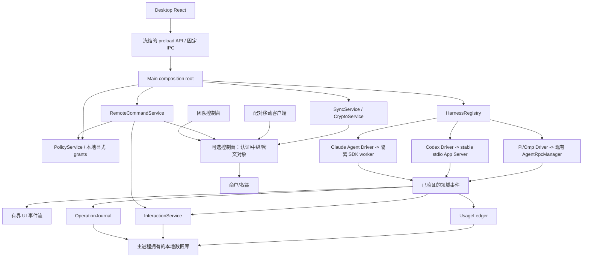
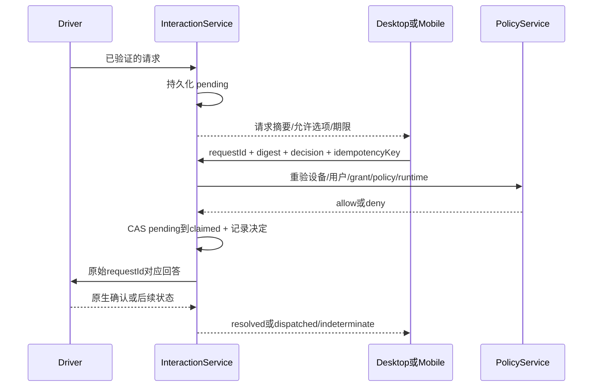

# PTX plan2 完整技术实现方案

[可行性评估](plan2-feasibility.md) · [实施与验收计划](plan2-delivery-plan.md)

状态：设计建议，尚未实现或批准。源码基线同评估报告。以下新增目录、类、接口、端点及默认数值均为拟议设计，不是当前仓库已有 API。当前实现参见 [Code Wiki](code-wiki/README.md)。

## 1. 范围与非目标

### 1.1 建设目标

在保留本地 Pi/OMP 工作流的前提下，分阶段提供：

1. 可解释、可对账的用量与估算费用。
2. 面向不同协议的 runtime/session/interaction 契约。
3. 条款与认证资格允许的新引擎接入。
4. 有签名、有范围、可撤销的跨端问答与审批。
5. 不携带执行权的加密数据镜像与同步。
6. 有边界的团队策略、操作记录、付费权益与可靠分发。

首个付费验证不依赖全部六项完成。按 [交付计划](plan2-delivery-plan.md) 的 Gate 启用，不能直接作为全量需求一次实现。

### 1.2 明确不做

- 不代理模型请求获利，不托管用户已有 harness 凭据，不代付/转售模型订阅。
- 不直接重写、上传备份后覆盖或跨设备合并 harness JSONL。
- 不将开发工作目录、授权、shell 权限或 bearer token 默认同步到云。
- 不开放任意远程 shell、任意 IPC 转发、任意 `agent.command`。
- 不宣传接入所有 CLI、拦截所有 OS 操作、确定的完整真实账单。
- 不默认跨 harness 共享会话或自动迁移模型上下文。
- 不让新付费模块锁住已存在的免费功能、用户记录和基本安全修复。

## 2. 总体架构



云端只传递消息和存储授权范围内数据，首版不运行用户代码。桌面在线才可执行；Ptx 退出或电脑休眠不保证远程指令按时完成。

### 2.1 服务边界

建议桌面增加 `electron/main/{harness-drivers,usage,interactions,remote,sync,policy,audit,entitlements}/`，共享类型拆到 `src/types/` 对应文件。renderer 不导入这些主进程模块。

云端控制面和商业模块建议独立仓库维护许可证、凭据和发布流水线。下文 `control-plane/` 为该仓库逻辑目录，不表示要直接塞入当前 Electron 包。前端共享的是序列化协议类型，不是主进程实现。

主进程仍负责授权；数据库写入/大批读取放到单独 utility process 或有界 worker，避免同步磁盘任务卡住 Electron 主循环。

## 3. 引擎契约与渐进迁移

### 3.1 为什么不能只改 HarnessRpcAdapter

现有 [HarnessRpcAdapter](../electron/main/agent-rpc/harness-adapter.ts) 翻译的是同一类 Pi/OMP 协议。[RpcRuntime](../electron/main/agent-rpc/runtime.ts) 的握手、pending response、状态和 session 路径都有具体假设。

新增 facade 层，先包裹旧 manager，不能把 Codex 的 `method/result` 或 Claude SDK 消息伪装成完全等价的旧 wire frames。

建议契约草图：

```ts
type SessionRef =
  | { kind: 'file'; harness: 'pi' | 'omp'; canonicalPath: string; nativeId?: string }
  | { kind: 'native'; harness: 'codex' | 'claude-agent'; nativeId: string }

interface HarnessDriver {
  descriptor(): HarnessDescriptorV2
  discover(): Promise<HarnessHealth>
  capabilities(): Promise<HarnessCapabilitySnapshot>
  listSessions(scope: AuthorizedProjectScope, cursor?: string): Promise<SessionPage>
  readSession(ref: ValidatedSessionRef, cursor?: string): Promise<TranscriptPage>
  start(input: AuthorizedRunInput): Promise<RunHandle>
  resume(input: AuthorizedResumeInput): Promise<RunHandle>
  send(run: RunHandle, input: PromptInput): Promise<CommandReceipt>
  interrupt(run: RunHandle): Promise<CommandReceipt>
  answer(request: ValidatedInteraction, answer: InteractionAnswer): Promise<AnswerReceipt>
  close(): Promise<void>
}
```

以上是模块设计草图，引用类型需要按需求定义，不是可直接编译的完整 `.ts` 文件。`Authorized*` 必须由主进程校验后内部构造，renderer 不能自报“已授权”。

### 3.2 Runtime、Session、Turn 分离

- `runtimeId`：本次本地进程/driver 实例，不跨重启复用。
- `sessionRef`：引擎原生会话标识，主进程持有。
- `sessionKey`：Ptx 不透明 ID，UI、云端只持有已授权引用，不暴露文件路径。
- `turnId`：一次用户请求及后续步骤，用于计量和审批。
- `workspaceGeneration`：继续只用于 renderer 迟到响应防护，不充当服务器授权。

新引擎先只显示 Ptx 创建或用户明确选中且 cwd 验证通过的会话；不能把 CLI `thread/list` 的所有账户历史默认上传或暴露给团队。

不能给 Codex thread 伪造 `.jsonl` 路径绕过 `canonicalSessionPath()`。调用链中的任务、schedule、飞书、协作、终端关联、浏览器 tab、归档及模型选择都改为使用 registry 解析后的 session 引用。

### 3.3 能力必须细分

建议 `HarnessCapabilitySnapshot` 包含：

| 能力 | 可选值/说明 |
| --- | --- |
| `history` | file、native-api、current-run-only |
| `resume/fork/rename` | supported/unsupported/experimental |
| `input` | text/image，以及已验证限制 |
| `interaction` | question、command-approval、file-approval、permission-expansion 分开 |
| `usage` | message、turn、session、context-only、unknown |
| `control` | interrupt、steer、queue 分开 |
| `toolIntegration` | Pi extension、stdio MCP、SDK tools、none |
| `policyEnforcement` | observed、pre-dispatch、managed-host |
| `authentication` | 模式、可用性、资格状态；不含 secret |

能力来源同时记录 executable/SDK 版本、schema hash 和验证时间。默认 fail closed：未知能力不显示为成功；fast mode、steer、fork 不静默模拟成完全等价语义。

### 3.4 迁移顺序

1. 引入 facade 与 DTO，仅包装旧 Pi/OMP，行为保持。
2. 为 session 增加 sidecar key 映射，先兼容 file API。
3. 消费者逐个转向 sessionKey，测试通过后再加入 native driver。
4. 废弃而不立即删除旧 file-based IPC；renderer 和 preload 随同版本更新。
5. 真正新增 harness 授权时才升级 desktop state schema。建议 v5，但版本号在实施时确认。
6. v5 不克隆 Pi 授权给 Codex/Claude；用户明确为新 harness 授权。
7. 不允许旧 v4 权威文件保留已撤销授权。迁移沿用备份、权威转移与旧版零授权 marker 思路，分别在真实 POSIX/Windows 测试；不能复制新文件后忽略旧版回滚。
8. 不支持安全降级时旧程序只读/拒绝启动，报告保留路径；禁止删除备份来绕过。

## 4. Codex 接入

### 4.1 技术路径

采用 `codex app-server --listen stdio://`，主进程固定 executable/argv，复用有界进程和 LF 解码原语。**不采用实验 WebSocket，也不对外暴露 App Server 端口。**

独立 `CodexTransport` 必须同时处理：

- 客户端 request → server response，关联 id/result/error。
- server notification → UI/领域事件。
- server request → 主进程审批 → 使用原 id 回答。

初始化必须等待 `initialize` 成功后发送 `initialized`，再调用 `thread/start` 或 `thread/resume`，不能照搬未等待初始化的简化示例。

| Ptx 语义 | 官方协议候选 |
| --- | --- |
| 模型目录 | `model/list`，目录不是 entitlement |
| 新建/恢复 | `thread/start` / `thread/resume` |
| 会话读取 | `thread/read` / `thread/turns/list`，以固定版本 stable schema 为准 |
| 开始/引导/停止 | `turn/start` / `turn/steer` / `turn/interrupt` |
| 正文 | `item/agentMessage/delta` |
| 工具与文件 | `item/started` / `item/completed` |
| 结束 | `turn/completed`，区分 completed/failed/interrupted |
| 用量 | `thread/tokenUsage/updated`，明确 total/last-turn 口径 |
| 命令审批 | `item/commandExecution/requestApproval` |
| 文件审批 | `item/fileChange/requestApproval` |
| 权限扩张 | `item/permissions/requestApproval`，首版远程拒绝 |
| 请求完成 | `serverRequest/resolved`，立即失效 pending decision |

以安装的固定 CLI 执行 `generate-ts` / `generate-json-schema` 生成协议夹具并存 schema hash；实施时才能确定支持版本区间，不在本方案虚构“已验证版本”。

禁止透传 `thread/shellCommand`、raw history injection、认证、插件安装、MCP OAuth 等所有方法。官方说明 `thread/shellCommand` 可在 sandbox 外运行，必须不进入通用 UI/远程桥。

### 4.2 生命周期

Beta 默认每个运行会话一个独立 App Server 进程，便于 cwd、环境、token 和退出隔离；空闲后回收。进程内多线程复用是后续优化，不作为初版必要条件。

最大活动进程数引入有界 admission，建议默认 4、队列 16，需压力测试后确定。不要沿用当前 manager 无固定活动数量的行为并声称资源已完全受控。

崩溃后标记 turn `indeterminate/interrupted`，通过原生读接口对齐，不能自动重发相同 prompt。重新开始由用户确认。

### 4.3 认证分支

| 分支 | 处理 |
| --- | --- |
| 本地/开源用途的既有 App Server auth | 仅在官方适用范围确认后使用；不读取 auth.json；不推导商业托管资格 |
| 用户自己的 API provider | 使用用户明确提供到 scoped 子进程环境的配置；不自动回退到订阅；商业模式仍需条款检查 |
| Sign in with ChatGPT | 独立 opt-in 认证模块，先资格/客户端注册；应用拥有自己的 OAuth token，不偷取 harness token |
| PTX 代付/共享账户 | 不支持 |

新 OAuth 模块如获批准，使用官方注册/回调/PKCE 方案；敏感 token 只在专用主进程/认证 worker 与 OS safeStorage 中，短期 access token 注入该子进程。不能回传 renderer、记录日志或上传 PTX 控制面；SDK 要求读本应用 token 文件时，优先核对是否支持安全存储适配，不降级为明文共享文件。

刷新由应用负责；依据官方指南，更新 token 后重启 App Server 并 `thread/resume`。在 turn 运行中到期的行为须实测，只能给出可见重试/中断结果，不能承诺无缝恢复或自动重做有副作用步骤。

## 5. Claude Agent 接入

### 5.1 推荐方式

优先评估 `@anthropic-ai/claude-agent-sdk` 的 API/官方云 provider 模式，作为单独 driver，而不是把 `claude -p --output-format stream-json` 当成现有双向 RPC 的替代。

SDK 在独立 utility process/worker 中运行；检查 Electron fuses、SDK 找 CLI 可执行文件方式与打包 ABI。不得设置 `ELECTRON_RUN_AS_NODE` 或关闭 fuses 来让 SDK 启动。

UI 名称用 “Claude Agent”，遵守官方品牌要求。未经批准不加入 claude.ai 订阅登录，也不把 SDK 接入宣传为官方 Claude Code 客户端。

### 5.2 交互与工具

- query 的 assistant/result/stream events 转为领域事件。
- `canUseTool` 将未知/需确认工具请求交给主进程 InteractionService。
- `AskUserQuestion` 是问题，不等于执行许可。
- Hooks 在官方支持的执行前阶段提供策略检查，但要验证内置工具、MCP、子代理和后台任务覆盖，不能只检查 canUseTool。
- resume 依据 native session ID，不把所有 `~/.claude` 内容扫描并导入。
- 默认不加载未经用户审查的 project/user settings、hooks、MCP。headless/SDK 自动发现具有执行风险；精确 `settingSources` 等配置依据固定版本测试。
- API key 从用户明确选择的外部环境/官方配置进入 worker；不读取 `~/.claude` OAuth 文件，不新增 renderer 明文密钥回传。

首版完成 text、恢复、停止、问题、已验证 tool permission 和用量；图片、fork、scheduler、协作按 capabilities 分别开放。API-only 接入仍会产生供应商费用，必须显示在 onboarding。

## 6. 跨引擎工具复用

现有 Pi/OMP TypeScript extensions 保留；新厂商不能直接加载它们。

增加受限的 `PtxToolPort`，复用现有浏览器、调度和同范围协作主进程服务：

- Pi/OMP：继续使用现有 extension + loopback token。
- Codex：仅在进程级配置准入验证后，以私有 stdio MCP shim 提供明确工具子集。
- Claude：通过 SDK custom tools/stdio MCP 的受控配置暴露同样的工具子集。

该内部 shim 使用固定安装路径、进程私有 token、有界 JSON；不在用户全局 MCP 配置写入网络 server，不打开任意插件安装或 `/mcp-auth`。若某固定版本不能做到进程级受控配置，首版关闭此能力。

scope 使用 `sessionKey + harness + localGrantId`，保持同 harness、同 cwd 的现有协作限制。跨品牌协作要单独做数据外发授权、用户预览和新威胁模型，本路线不默认启用。

## 7. 事件总线与持久化

### 7.1 双通道

在经过 transport 大小约束、schema 检查、敏感字段过滤后，**UI 限流前**分成：

1. domain lane：终结 usage、interaction、执行接纳与策略决定等小型有界事件，持久化或返回明确失败。
2. presentation lane：正文 token、工具进度、光标等可合并丢弃事件，维持现有 UI 预算。

不能把 unbounded raw stdout 复制到磁盘。超过协议输入预算仍拒绝/截断并写 gap 标记；未报告的外部动作不会被这次重构“补全”。

拟议 envelope：

```ts
interface DomainEvent {
  version: 1
  eventId: string
  deviceId: string
  runtimeId: string
  sessionKey: string
  turnId?: string
  sequence: number
  occurredAt: string
  receivedAt: string
  kind: 'usage' | 'interaction' | 'lifecycle' | 'policy' | 'operation' | 'gap'
  payload: ValidatedDomainPayload
}
```

主进程维护 device/runtime sequence；如果 native event 有稳定 ID，保留以跨重启去重。`eventId` 不能随重放随机变化后被当作唯一事实依据。

### 7.2 本地存储

新高频数据不塞入全量重写的 desktop state JSON。建议 `userData/ptx-activity-v1.sqlite`，通过 `ActivityStore` 接口访问。

P0 必须验证目标 Electron 下 `node:sqlite`、worker、Windows/macOS/Linux 打包可用性；如不满足，选择维护良好的 SQLite binding，并补依赖 pin、native ABI、ASAR 和审计测试。不能在设计阶段假设当前应用已经具有该依赖。

建议表：

| 表 | 关键键 | 内容 |
| --- | --- | --- |
| `schema_migrations` | version | schema 与迁移状态 |
| `session_refs` | session_key | native ref 与本机授权关联 |
| `usage_observations` | source_scope + native_id + revision | 归一化的计量事实 |
| `usage_totals` | aggregate dimensions | 可重建投影，不是原始事实 |
| `price_books` | provider/model/version/currency | 生效区间及计价组成 |
| `interaction_requests` | request_id | 待响应、决策与 dispatch 状态 |
| `operation_events` | device_id + sequence | 策略/接纳与 gap，hash chain |
| `remote_receipts` | device + command_id | 去重、结果与 indeterminate |
| `sync_outbox` | object_id + revision | 待发送密文及 cursor |

唯一写入 owner、WAL、事务、busy timeout、备份和有界队列。敏感路径只本地保存；默认无原始 prompt、完整工具参数或 token。SQLite 默认不等于加密，文件权限与磁盘加密也不等于应用层加密，需如实说明。

建议默认原始计量保留 90 天、聚合 365 天、命令回执至少覆盖消息有效期及重放窗口；可导出/删除。审批 tombstone 和账务合规保留分开，删除策略不能破坏仍有效请求的防重放。

磁盘满时：用量标记 incomplete，普通聊天不因非必要分析失败中断；权限决定写入失败则拒绝放行；Team managed 审计无法持久化时按策略暂停新有副作用操作。

## 8. 用量与估算费用

### 8.1 计量模型

每个 observation 至少包含：

```text
deviceId, harness, executableVersion, sessionKey, turnId?
nativeMessageId?, nativeRequestId?, sourceScope, sourceRevision
provider, model, inputTokens?, outputTokens?
cacheReadTokens?, cacheWriteTokens?, reasoningTokens?
accountingScope: message | call | turn | session
measurementKind: delta | cumulative
reportedAmount?, reportedCurrency?
priceBookVersion?, estimatedAmount?
billingMode: api | subscription | unknown
provenance: harness | transcript-backfill | manual
quality: complete | partial | estimated | unknown
observedAt, occurredAt, receivedAt
```

费用用十进制定点整数/字符串，IPC 不直接传 BigInt，不用 JS 浮点累计钱。没有提供的 token 字段保持 null；必须明确 reasoning 是否已包含在 output，cache 是否已包含 input。

### 8.2 去重及对齐算法

1. 为每个 driver/版本定义 `UsageAccountingProfile`，固定粒度和累计周期。
2. 相同 native message/request 的重复通知更新同一 observation，不重复求和。
3. cumulative 先验证同一计量 epoch，再计算差值；恢复/重置/小于旧值时产生 correction/gap，不简单 clamp 成 0。
4. 不同时将 assistant step 用量、turn 汇总、session total 三份全加；选择唯一计量主粒度，汇总只用于对账。
5. 没有稳定原生 ID，使用 session + 被验证的记录位置/内容摘要构建本地 key，明确可靠度下降；不跨截断/重写 blindly 复用 offset。
6. 已授权 JSONL 只读回填，使用有界增量 parser；新 native 会话通过官方 read API 对齐。
7. 回填、live、设备迁移导入使用同一个事实键，避免恢复后翻倍。
8. 不一致时显示 partial/discrepancy，而不是选择更“好看”的总数。

Claude CLI 与 SDK 当前文档的累计口径有差异，因此此处必须以固定模式、版本、真实两次 resume trace 验收；不是直接套用任一段示例。

### 8.3 费用展示

界面明确分四栏：

- token 使用量：来自引擎，或 unknown。
- 估算 API 价值：按版本化价格计算，不是发票。
- 引擎报告费用：仍可能是客户端估计，不称供应商已扣款。
- 可选订阅分摊：用户输入月费后按选定规则摊销，仅管理口径。

未来供应商账单导入是独立的只读对账功能，需要用户另授权或手动导入，不通过读取 harness 凭据自动获取。

价格表带 currency、effectiveFrom、cache 层级、长上下文阈值、来源 URL 和更新时间。未知模型不猜价；外币总计先分币种，汇率换算需要来源和日期。

### 8.4 预算与报表

MVP 只做 50%/80%/100% 软提醒，阈值和预算均由用户设置。

后续“停止新任务”只能阻止 Ptx 下一次接纳，不能回滚已发请求或担保停止供应商计费。真正组织硬上限需计量预约、执行网关或供应商预算能力，不把 notification 包装成硬限制。

UI 增加 `UsagePage`、任务详情 `UsageSummary`；时间筛选有明确 timezone 和 UTC 存储边界。CSV 导出转义公式起始字符，支持只导出汇总，默认不带路径和正文。

## 9. 统一问题与审批服务

### 9.1 主进程唯一状态源

增加 `InteractionService`；将当前 renderer `useExtensionUi` 的 pending ownership/timeout 下移。renderer 只展示和提交决定。

兼容迁移时现有 `agent.command({type:'extension_ui_response'})` 也必须路由同一 registry，不保留绕过新审批规则的旧入口。旧问卷逐题 response 由 service 统一编码，UI 不自行依次发原始 RPC。

```ts
interface InteractionRequest {
  id: string
  kind: 'question' | 'approval'
  runtimeId: string
  runtimeGeneration: number
  sessionKey: string
  turnId?: string
  nativeRequestId: string
  payloadDigest: string
  grantRevision: number
  policyRevision: number
  allowedAnswers: readonly string[]
  expiresAt: string
  status: 'pending' | 'claimed' | 'dispatched' | 'resolved'
    | 'denied' | 'expired' | 'cancelled' | 'indeterminate'
}
```

原始命令、cwd、文件 diff 和用户输入可能敏感，持有在本机；只有用户启用相应远程披露后才密文传输。

### 9.2 决策流程



两端同时回答，只能一个 CAS 成功；其余返回 already-resolved。payload、grant 或 policy revision 改变时旧回答失效，重新询问。

目前 Pi/OMP `extension_ui_response` 的成功只表示 transport 写入完成，无 CLI 业务 ACK。因此 `dispatched` 不自动称“代理已采纳”；通过后续明确事件确认或显示“已发送，确认状态未知”。不能承诺跨崩溃 exactly-once 执行。

### 9.3 超时、取消和限制

- pending 有期限，建议用户问题最多 5 分钟，审批 2 分钟，取本地策略与 native deadline 的较短值。
- 超时默认 deny/cancel，不自动允许；需安全停止 runtime 时明确告知。
- runtime 退出、turn 完成、会话归档、grant 撤销、手机撤销、策略更新导致相关请求失效。
- 应用重启不把旧请求重新发回新 runtime；标记 cancelled/indeterminate。
- 未获得原生 request ID、稳定请求参数或确认不能安全绑定的事件，仅通知，不提供批准按钮。
- 远程仅 allow-once/deny；不支持 allow-always、修改命令、扩大目录/网络权限。
- Codex network approval 与 shell approval 分开渲染；不能拿 command 文本掩盖实际 host/port 授权。

## 10. 移动入口

### 10.1 先复用飞书验证需求

保留已有继续对话和停止能力免费。新结构化待办只在用户显式启用后增加：

- “待处理列表”“问题选择”“一次性允许/拒绝”的结构化命令或卡片。
- 所有动作归 InteractionService，不直接调用原始 agent RPC。
- 验证 app-scoped Open ID、p2p、消息 ID、有效期、绑定项目及请求 digest。
- 卡片 callback 是新的事件准入面，需要对应 SDK/schema 测试；可以先用带请求短码的文字命令验证交互，不借此省略完整请求核对。
- 手机必须能看到足以判断的 command/diff；信息截断或未知时只允许拒绝/回桌面。

上线新远程策略前，必须处理已有 `/发图` 分支：当前它在 `receive()` 的项目重新授权之前执行，只限制图片类型、大小和绝对路径，不限制项目根。应先验证绑定/代次/项目仍有效，再对文件执行 canonical containment 与安全读取；默认限定显式允许的项目或桌面另行授权的导出目录。受管模式默认关闭该命令。属于安全边界收紧，需迁移提示，但不是把现有能力改为付费；不能让旧入口绕过新的 PolicyService。

**飞书消息不是 PTX E2EE 通道。** 飞书平台及授权企业体系可能处理内容；不能宣传“服务器看不到审批内容”。高敏感团队可禁用该通道。

### 10.2 通用移动伴侣

需求验证后增加独立 PWA，首版只提供设备状态、任务摘要、问答、有限审批、停止和明确授权的续发。不提供 remote terminal、任意文件路径、能力安装、切换授权项目。

普通 web PWA 可做 UX Beta；但托管页面的代码可被服务端更新，无法对恶意代码发布方保证密钥保密。高保障 E2EE/高风险审批需经独立审查的签名客户端或可信发行渠道。不得把 WebCrypto non-extractable 自动等同于服务端无法读取用户数据。

## 11. 控制面、设备配对与远程命令

### 11.1 服务栈

推荐最小 TypeScript 控制面（Fastify 或等价维护良好框架），托管 PostgreSQL、S3-compatible 密文对象存储、出站 WSS relay。初期不引入 Redis、Kafka、Kubernetes；规模需要再增加。

认证优先复用成熟 OIDC/passkey 服务，不自行实现密码系统。支付适配国内/国际商户，供应商在经营主体、地区和资金条件确认后选择。

### 11.2 配对

1. 桌面生成设备 identity key，私钥进 OS safeStorage。
2. 桌面在本机显示短期、一次性的 QR challenge，包含设备公钥指纹和 nonce，不含长期 secret。
3. 手机生成密钥，扫码发 pairing proposal。
4. 桌面展示手机名和短认证串，由用户本机确认。
5. 桌面签署该手机能力 grant：指定本机、项目集合、动作和期限。
6. 保存配对证书；cloud account 登录本身不能赋予执行本机任务的权限。

key 交换使用审计过的协议/库与固定 suite（例如 P-256 ECDH + HKDF-SHA256 + AES-GCM，独立签名 key），不自创“二维码加密”。实际密码学方案和 test vectors 在上线前独立评审。

### 11.3 命令 envelope

```text
protocolVersion, commandId, senderDeviceId, targetDeviceId
sessionKey, action, payloadDigest
issuedAt, expiresAt, nonce
grantRevision, policyRevision, pairingKeyEpoch
ciphertext, signature
```

signature 覆盖规范化 header、ciphertext 和上下文；AEAD AAD 绑定 account/device/object/revision，阻断跨账户、跨设备密文替换。

relay 验证登录身份、路由与大小；桌面解密后再次验证设备签名、配对 grant、时钟、nonce、项目、会话及 runtime。server 无权生成客户端有效签名。

建议默认命令 TTL 2 分钟、允许时钟误差 30 秒、单设备每分钟 30 条、正文上限 64 KiB；超限返回可见错误。离线手机决定不能在隔夜电脑启动后突然执行。

### 11.4 可靠投递

relay 是 at-least-once；桌面 `remote_receipts` 按 `senderDeviceId + commandId` 唯一。

接纳事务：校验 → 记录 pending receipt → 权限/策略重验 → 持久化 claimed → 调 driver → 记录 outcome。崩溃发生在外部副作用和落盘之间时，结果为 indeterminate，禁止盲目重发。

客户端重试相同 commandId 查询结果；新 commandId 代表用户明确的新意图。对 prompt、批准、Git 等不能声称数据库事务涵盖外部 CLI 副作用。

### 11.5 拟议云 API

| API | 行为及限制 |
| --- | --- |
| `POST /v1/devices` | 登录用户登记设备公钥，无执行权 |
| `POST /v1/pairings` | 短期 proposal，需已配对桌面签名完成 |
| `DELETE /v1/devices/:id` | 撤销云路由及配对 epoch，通知在线设备 |
| `GET /v1/devices` | 脱敏状态，lastSeen 不代表可执行 |
| `WSS /v1/relay` | 密文命令与回执，JWT scope + 速率限制 |
| `POST /v1/sync/batches` | 幂等密文 revision 与 tombstone |
| `GET /v1/sync/changes?cursor=` | 账户隔离分页，不接受跨账户游标 |
| `GET /v1/entitlements` | 当前账号购买权益，无模型凭据 |
| `POST /v1/billing/checkout` | 后端创建真实订单 |
| `POST /v1/billing/webhooks/:provider` | 原始 body 验签 + 回调幂等 |

所有身份、账户和 tenant 从经验证服务端上下文确定，不相信客户端自报 userId/tenantId。

## 12. E2EE 同步

### 12.1 数据分类

| 数据 | 首版策略 |
| --- | --- |
| 主题、语言、无路径偏好 | 可选同步 |
| 模板与逻辑项目名称 | 可选加密同步 |
| 任务状态/用量汇总 | 可选密文镜像，任务执行 owner 不转移 |
| 会话正文/附件 | 默认关闭，独立内容许可与配额 |
| canonical cwd、目录身份、grants | 不同步为权限 |
| harness auth、OAuth refresh token、capability token | 不同步 |
| 原始 JSONL | 不覆盖、不自动重建为本机可恢复会话 |

其他电脑上的会话默认是只读镜像。要继续执行，回到原 device；新 device 必须有已存在且验证通过的 native session 或由用户显式创建新的会话并选取上下文。

### 12.2 Key 管理

账户级数据密钥由客户端生成，按已验证设备公钥包装；对象使用独立 data key、唯一 nonce 和版本化 AAD。云端只存 wrapped keys 和密文。

新设备须经旧设备或离线恢复 key 授权，不靠重置邮箱就自动得到旧内容。无旧设备且丢失恢复 key 时旧数据不可恢复，必须在开启前明确告知。

撤销设备后轮换 epoch，未来密钥不再分发给它；**无法撤销它已经下载/解密的数据**。恶意 relay 仍可丢弃/延迟消息、分析路由元数据；使用 signed checkpoint、版本防回滚及 gap 可见性降低影响，不声称阻断一切服务器攻击。

### 12.3 冲突与删除

- 模板/非安全偏好按对象 revision CAS；并发编辑创建冲突副本，不静默覆盖。
- 任务/审批采用 owner device 事件序列，不允许其他设备随意改 `accepted` 或“已执行”。
- 不采用盲目 wall-clock last-write-wins 处理安全字段。
- 内容附件分块加密，content hash 针对密文或局部设计，避免全局明文去重泄露内容相等。
- tombstone、版本窗口和恢复流程明确；不得因长时间离线设备回连让已删数据复活。
- 建议目标：删除后 24 小时内不可访问，备份最长 30 天轮换清除；正式承诺按实际供应商能力与法律要求确认。

## 13. 团队治理

### 13.1 从 observe/advisory 起步

首版 Team 提供组织、成员、共享模板、策略建议、连接资产清单、Ptx 接纳操作记录与汇总报表，不承诺阻止用户直接运行 CLI。

角色至少 owner/admin/member/auditor/billing；tenant 级访问控制与数据库 RLS/服务检查双层，跨 tenant 负例必测。SSO 采用成熟身份平台，SCIM 停用事件撤销控制面 session、设备权限及后续远程动作。

云策略是签名、带版本和期限的 policy：

```text
tenantId, policyId, revision, issuer, issuedAt, expiresAt
allowedHarnesses, allowedVersions, allowedCapabilities
toolRules, remoteActionRules, retentionPolicy, auditMode
signature
```

云服务无权增加本机 grant。实际执行权限是：

```text
本机用户显式授权 ∩ 有效组织限制 ∩ 引擎可强制的权限 ∩ 已批准请求范围
```

策略更新对新任务立即生效；已有任务无法施加新限制时暂停/终止并要求重启，不假装动态降权已经执行。

### 13.2 跨入口策略检查

统一 `PolicyService.evaluate(ActionContext)`，至少覆盖：

- agent start/resume/send。
- schedule create/update/admission/execution。
- voice start_task。
- collaboration create/send。
- Feishu/通用 remote。
- Git mutation、项目脚本、PTY 创建。
- MCP/plugin 安装与配置。
- 浏览器下载及新增外发入口。

`policy-only` 管住这些入口不代表管住 CLI 内部 Bash/MCP。对无法验证执行前拦截的引擎，显示 advisory；managed 模式下拒绝使用，不能自动降级。

### 13.3 Managed 模式

需要独立企业 SKU/工程项目：

- 受管设备/MDM，签名配置与版本锁定。
- 官方 harness hooks/sandbox/permissions 的完整性测试。
- 拒绝 bypass 模式、未审查插件、设置覆盖与网络路径。
- 必要时使用隔离 runner 或企业网关强制执行，明确不属于个人桌面沙箱。
- 策略过期且不能刷新时默认禁止新的受管执行；不删除/锁住本地代码、记录和免费离线浏览。
- 撤销离线设备不能瞬时送达；通过短 policy lease 控制最长离线授权窗口，并公开该窗口。

受管 OS 中管理员/内核攻击者仍超出桌面应用自身保证。

## 14. 操作记录与审计

`OperationJournal` 记录动作接纳、权限决定、配置变更、运行生命周期、已报告工具元数据、缺口。正文/完整参数默认不采集，分类脱敏允许按组织另行选择。

本地链：

```text
eventHash = SHA256(canonicalEvent)
chainHash = SHA256(previousChainHash + eventHash + sequence)
checkpoint = Sign(deviceKey, deviceId + epoch + sequence + chainHash)
```

使用标准 canonical serialization 和 domain separation；远端接收签名 checkpoint 后给出不可回滚 receipt，保存到权限分离、追加语义/WORM 存储。管理员删除权限、retention lock、导出验证都必须独立测试。

安全边界：

- hash chain 能检测锚定后历史改变，不能证明源事件一定真实。
- 本机 key 被窃、程序被 patch 或未观测动作无法由哈希“修复”。
- 断线期间尚未锚定尾部可能丢失，必须记录和显示 gap。
- 供应商 tool result 中的“测试通过”与实际测试进程退出证据分层，不相互冒充。
- 审计模式云端可索引的脱敏字段由企业明确授权，不与“所有内容服务器绝对不可见”的个人 E2EE 声明混用。

对外用“可校验、带覆盖范围的操作记录”，只有通过明确受管环境控制评审后才能使用更强合规表述。

## 15. 支付、权益与许可

### 15.1 先明确卖什么

既有 MIT 功能持续免费；试验收费为已公示的发行维护/支持或新增服务，不倒置成“未付款无法查看自己任务”。

新增专有模块或控制面采用独立许可和仓库边界。不能通过远程开关回收既有源码许可；不以防破解为核心工程投入。

### 15.2 最小商户模型

`Account / Product / Price / Order / PaymentEvent / Entitlement / DeviceActivation`。按商户与地区选择支付渠道，不写死一个尚未可用的 merchant ID。

支付流程：

1. 主进程打开固定允许域名 checkout，order 由服务端创建。
2. 支付处理商 webhook 验证原始 body 签名、时间及 event ID。
3. 事务内持久化 PaymentEvent，幂等推进订单和权益。
4. 客户端只查询服务端权益；返回页面或 renderer `paid=true` 不生效。
5. 退款、拒付、到期和恢复由同一权益状态机处理，乱序回调不得恢复已退款订单。

状态区分 `pending/active/past_due/expired/refunded/revoked`，不把退款删除当作会话删除。

### 15.3 离线权益

可选签名 entitlement 包含产品、feature scope、账号、有效期、grace、签名 key ID；验签在主进程，公开密钥随可信发行更新。建议 7 天个人云功能宽限期，正式时按经营政策确认。

离线无法即时知道退款或设备撤销，因此不能承诺即时收回离线功能。记录最近可信服务器时间处理时钟回拨；不能因时钟异常删除数据。MIT 客户端可被修改，客户端 DRM 不能成为主要安全或盈利假设。

云端服务仍验证真实权益与配额。到期后禁止新付费上传/新付费服务请求，不影响免费能力、现有记录读取和合理的数据导出。

## 16. 签名发行、维护与支持

复用现有 [发布验证](validation.md) 和 `UpdateService`，不是重新写一个下载器：

- 原生 OS 打包、native 模块与 ASAR 结构门禁继续保持。
- 配置真实 Developer ID、公证、Windows 期望签名者，不以未签名 QA 宣传正式发行。
- stable/beta 分渠道，按真实版本递增，逐步灰度。
- 控制面 feature flags 只关闭新危险/未验证能力，不能借此开启任意执行。
- 支持包默认元数据、错误码、版本与使用量完整性；正文、路径、密钥和账户标识默认剔除，用户发送前预览。
- 免费安全修复和既有更新路径不追溯变付费；收费 SLA 必须与实际支持能力一致。

## 17. 市场与定制集成的远期方案

不进入个人 Beta，但为原文方向给出最低完整边界。

### 17.1 插件市场

先做 curated catalog，不做交易。待供给、使用与付款证据成立后拆为：

- Registry：不可变版本、publisher 身份、manifest、artifact hash、签名及 license。
- Review：恶意包扫描、依赖/SBOM、沙箱测试、权限声明、人工审查和举报。
- Install：复用 `PluginService` 的 source/grant 检查，先显示新权限 diff，禁止无提示执行安装脚本。
- Revocation：发布签名撤销列表，禁止新安装；现有启用状态提示/按政策停用，不随意删除用户文件。
- Commerce：独立订单、开发者分账、税务/KYC、退款、争议与地区合规。
- 不能声称“签名过就安全”；签名只证明来源，恶意行为仍需权限和审查。

抽成比例在服务成本和供给验证后定；不把 20–30% 当作已验证行业必然值。

### 17.2 定制集成

每份合同定义：协议与版本、商业资格、支持 OS、必需能力、权限边界、验收场景、维护期限、上游变更责任、源码归属。

交付复用 driver contract 与 fixture；不为单个客户绕过来源验证或读取他人凭据。公开主干只接收通用接口，客户 secret、内网域名和代码存私有交付仓库。

## 18. 新增 IPC 与页面

| API/页面 | 主进程责任 | renderer/移动职责 |
| --- | --- | --- |
| `usage.summary/query/export` | scope、分页、汇总、脱敏 | 图表、缺口与估算标签 |
| `interactions.list/respond/onChanged` | request CAS、策略、原生回应 | 问题/审批展示，不持有最终决定源 |
| `devices.list/beginPairing/revoke` | 配对、密钥、不透明 device ID | QR 与本机确认 |
| `remote.status/setEnabled` | 出站连接、授权范围和回执 | 离线/待处理/已发送/未知结果 |
| `sync.status/configure/export` | 内容分类、密钥、revision | 显式勾选与冲突处理 |
| `policy.effective/validate` | 验签、限制交集、执行检查 | 说明阻塞原因 |
| `audit.query/export` | 权限、去标识化、验证包 | 覆盖范围/gap |
| `entitlements.status/restore` | 真实服务查询与验签 | 到期说明，保留免费入口 |

使用当前 `registerIpc` 统一来源门禁、冻结 preload，所有未知输入主进程 schema 检查。没有 `invokeRaw`、`remote.exec`、`driver.rawCommand`。

新页面为 `UsagePage`、`InteractionsPanel`、`DeviceSettings`、`SyncSettings`、`AccountSettings`；团队管理在控制面 web。遵循 [CSS 约定](css-guidelines.md)、中英文 i18n、键盘操作和 lazy chunk 预算。

## 19. 隐私、部署与运维

### 19.1 隐私默认值

- 现有“没有新增上传”的隐私声明在云功能上线前必须更新，不静默改变。
- 区分 code/model 请求、飞书出站、Ptx 控制面元数据、E2EE 内容与企业审计。
- 行为验证默认自愿，不收 prompt、源码、工具原始参数、真实路径和模型 secret。
- 云默认关闭，首次开启展示数据清单、保留期限、地区、第三方处理商和关闭/删除行为。
- 不承诺法务未确认的数据驻留/跨境/企业合规。

### 19.2 部署与恢复

控制面 dev/staging/prod 隔离，secret manager、TLS、数据库最小角色、迁移先 expand 再 contract；tenant backup 恢复需授权和演练。

个人云建议目标（非已达 SLA）：控制面月可用性 99.5%，元数据 RPO 24 小时、RTO 8 小时；本地执行不依赖云可用。付费 SLA 上线前用实际成本和演练结果重新确认。

初始性能验收目标：100k usage rows 汇总 p95 < 300ms（指定参考机器）；在线正常网络的远程问答回执 p95 < 3 秒（排除模型执行/用户等待）；新后台记录对 renderer 流式帧时间增加 p95 < 5ms。测试中记录机器、网络、样本，不当作所有用户保证。

可观测性仅记录 trace ID、错误码、字节数、队列深度、gap 和延迟；payload 不进日志。报警覆盖支付 webhook 失败、签名错误、审批积压、relay 队列和存储预算。

## 20. 实施与发布顺序

1. 完成资格、用户、协议和存储 PoC，不改变现有免费体验。
2. facade 包装 Pi/OMP，建立领域事件双通道。
3. 用量账本和主进程 interaction registry 分开上线。
4. 在条件允许时单独发布一个新 driver；按能力降级。
5. 飞书先验证移动处理，再开配对/relay/PWA。
6. 支付开通前完成条款、沙盒与退款恢复；仅售已可交付范围。
7. E2EE 转录镜像与 Team 各自立项，不夹带进前序发布。
8. 每阶段验证旧项目、旧授权、旧任务和数据读取；失败按功能旗标关闭新入口，不擦除用户数据。

具体任务、工时和测试矩阵见 [实施与验收计划](plan2-delivery-plan.md)。
